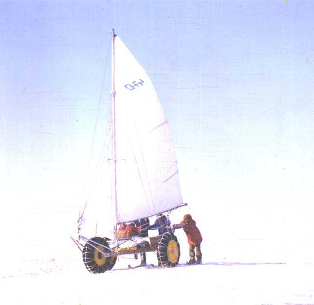
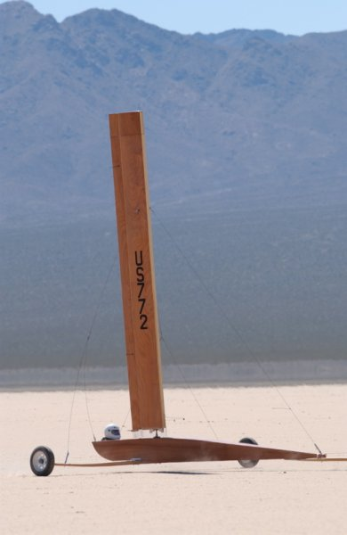
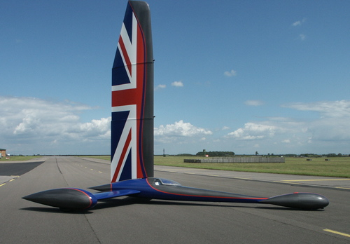
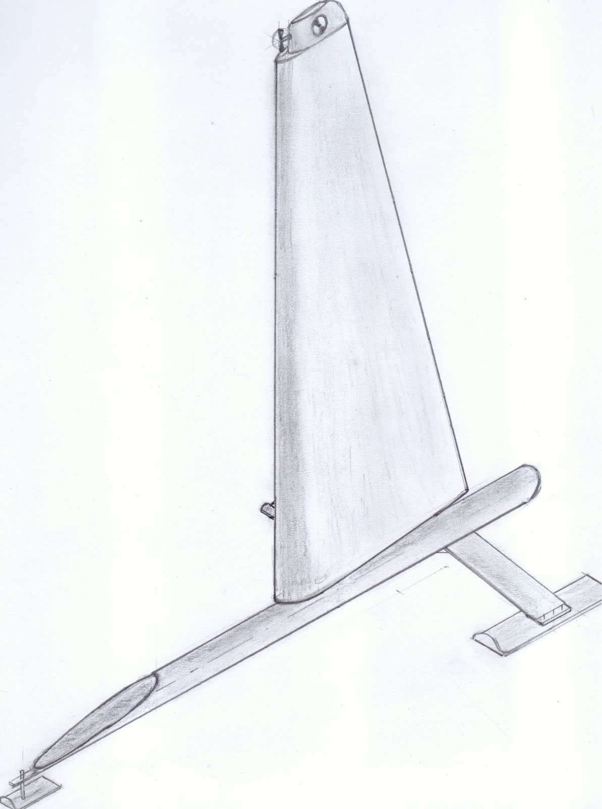
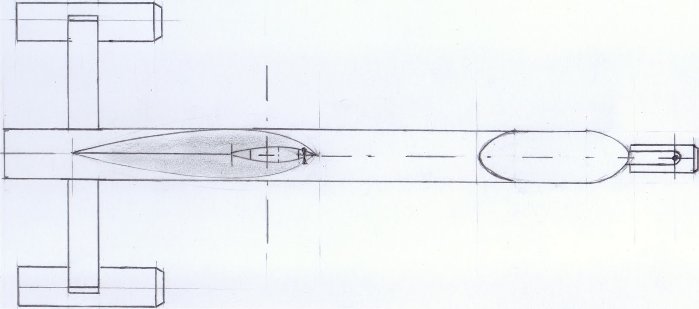
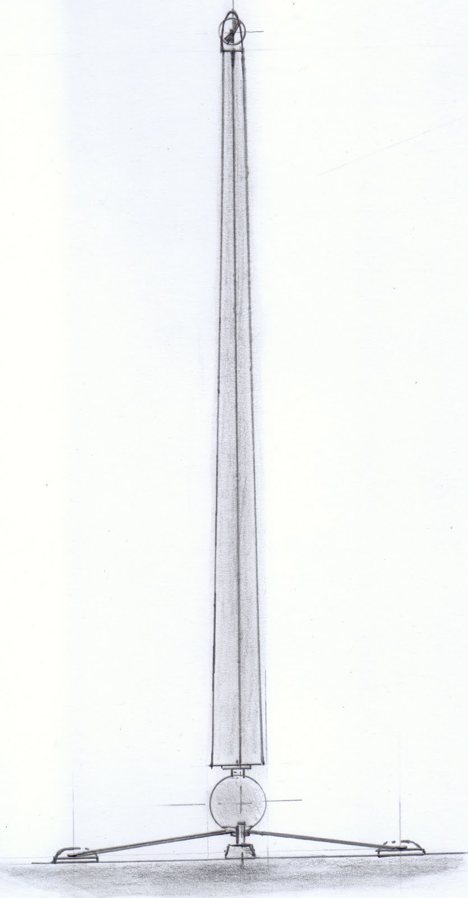
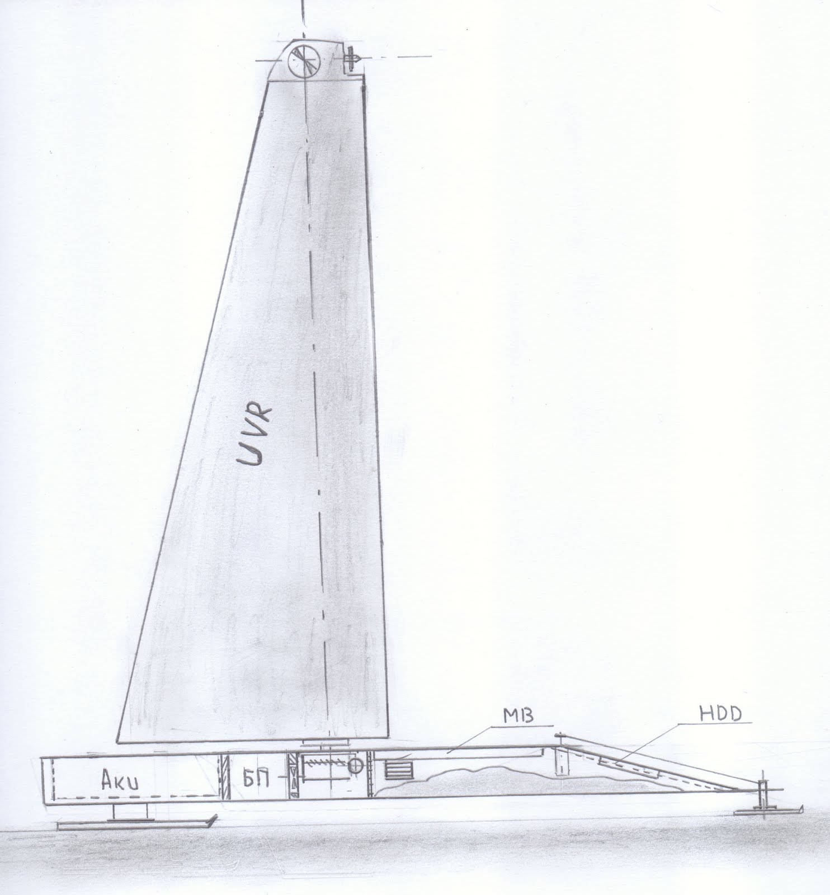

Итак после разных и порой неудачных експериментов с ездящими роботами (хотя откровенно говоря до автономности им ох как было далеко) закортело создать по настоящему автономного робота.
Автономность в данном случае должна быть максимально полной:
1. автономность по движению
2. автономность по питанию
3. автономность по системам управления (проще говоря cpu on board)

Ввиду отсутствия наличия достаточно емких акуммуляторов позволяющих обеспечить серьезную автономность , да и в угоду модной нынче тенденции на енергосберигающие технологии было решено применить их в робототехнике.
А именно - движетелем робота будет ветер. Аккумулятор будет снабжать питанием лиш сервоприводы управления и бортовой компьютер. 
В качестве прототипа робота был выбран тримаран с парусом-крылом.
На первом этапе было решено не тратить время и нервы на обеспечение герметичности и выбрать в качестве первого приближения несколько другое устройство - буер.

Итак первые наброски компоновки дали вот такого красавца:

