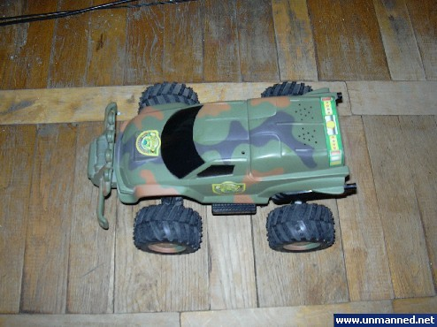
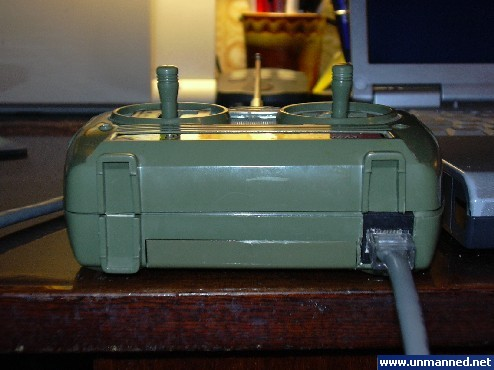
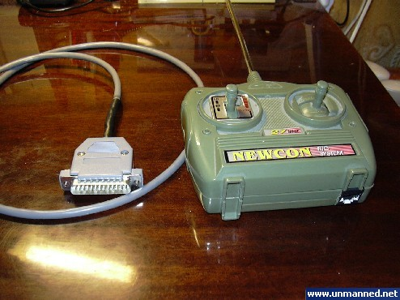
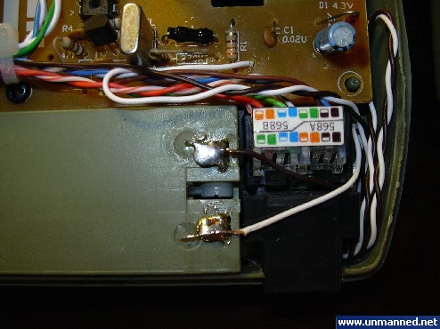
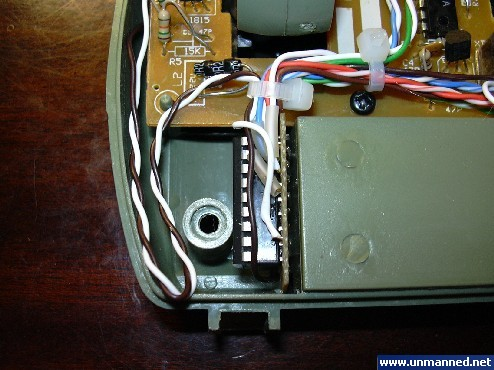
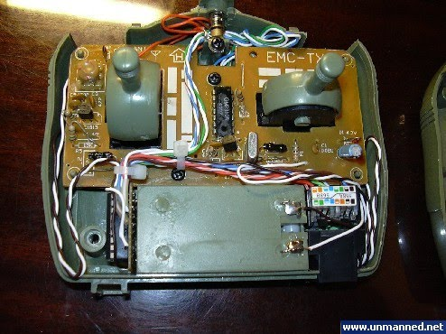
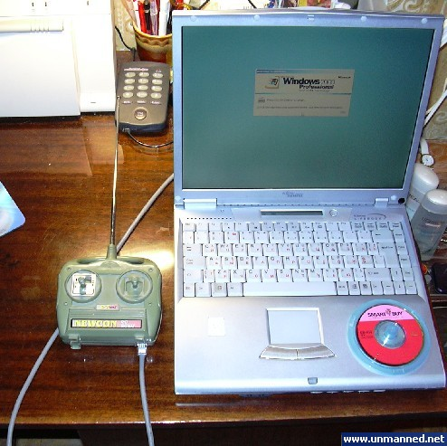
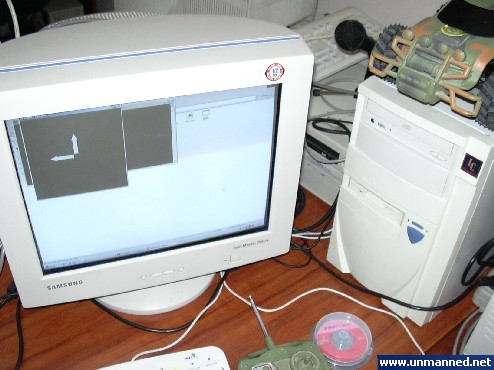
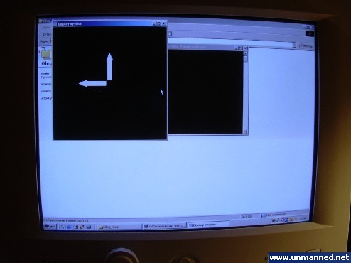
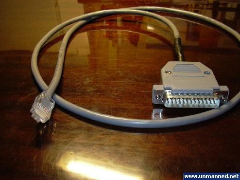

Весь материал ниже написан в году этак 2004 и выложен тут просто как предистория

##### Вариант 1 - интегрированный пульт управления

В этом варианте за основу была взята детская радиоуправляемая машинка китайского Noname производства.

Переделке подвергся лишь пульт дистанционного управления данной игрушкой. В него необходимо было встроить микросхему контроля порта и соединить ее с контрольными цепями управления пульта. Для обеспечения модульности архитектуры было принято решения в пульт интегрировать розетку RJ-45 для сопряжения с компьютером. Таким образом я избежал волочащегося пультом шнура. Необходимый шнур LPT- RJ-45 подключался к пульту только по мере необходимости.

Источником питания схемы служит штатная батарея пульта радиоуправления. В пустотах пульта вокруг данной батареи и разместили микросхему контроля и порт RJ-45.

Соответственно для сопряжения с компьютером был изготовлен шнур LPT- RJ-45, который позволял делать "горячее" подключения пульта управления к компьютеру.

Управляющая программа была адаптирована под клавиши курсора стандартной клавиатуры , которыми теперь стало возможно осуществлять управления автомобилем

Испытания получившегося робота-гибрида прошли на ура. Машина отлично слушалась команд и каждый управляющей ею получил незабываемое довольствие. Испытания проводились как с использованием ноутбука так и со стационарного компьютера.

Данные испытания только разожгли интерес к проекту и я решил сделать улучшенное продолжение данного робота.

Результаты испытаний были засняты на камеру и представлены здесь  

<video controls width="320" height="240">
  <source src="../assets/videos/2009-10-04-variant-1-integrated-remote-control/video-1.mp4" type="video/mp4">
</video>

<video controls width="320" height="240">
  <source src="../assets/videos/2009-10-04-variant-1-integrated-remote-control/video-2.mp4" type="video/mp4">
</video>
