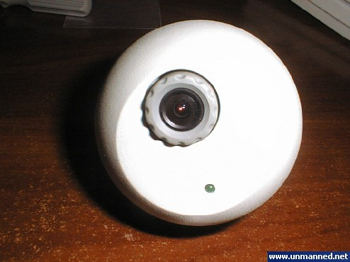
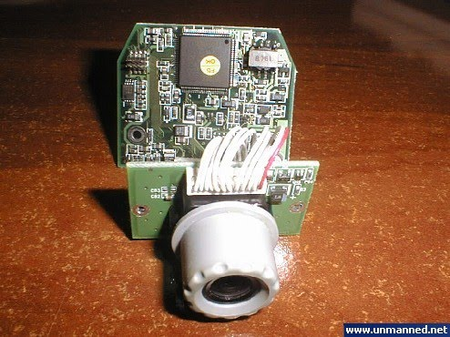
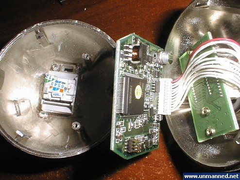
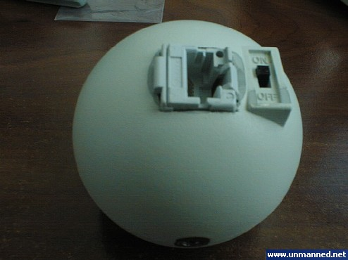
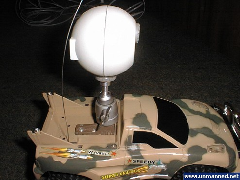
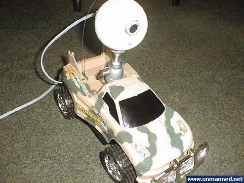
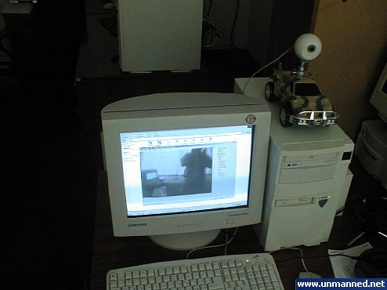
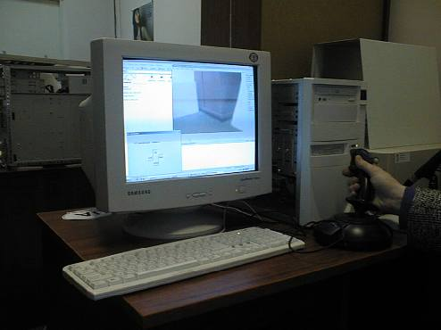

Для обеспечения автономности данных прототипов необходимо написания программы обработки изображения и автоориентирования. 
А для этого необходим тестовый робот с большой степенью свободы и возможностью передавать изображения с настраиваемой камеры. USB камеру использовать нельзя по причине ограничений на длину шнура.
Cоответственно было принято решения использовать цветную PAL камеру и плату захвата видеоизображения установленную в host-компьютере. Был выбран комплект для проведения видеоконференций состоящий из PAL камеры и платы видеовхода на BT848. Для обеспечения модульности архитектуры камера была доработана и стандартный шнур был заменен на интегрированную в корпус камеры розетку RJ-45.

От камеры к плате захвата видео идут 4 линии: 2 питания и 2 видеосигнала.В качестве пробного кабеля был выбран телефонный 4-х жильный кабель длиной 10 метров. Хоть он и давал некоторое ухудшение получаемой картинки но и обеспечивал большую свободу перемещений для машинки- робота.

Машинка была доработана с целью установки на неё стандартного фото-штатива для крепления камеры. Данный штатив обеспечивает возможность регулировки углов установки камеры на автомобиле. В результате мы получили следующую конструкцию. 

Испытания прошли довольно успешно и дали достаточно много наработок касательно углов установки камеры, освещенности, необходимости дополнительных датчиков.

Программное обеспечение было доработано с целью осуществления захвата видео и вывода на экран стрелок указателей направления движения робота.
Было принято решения об организации поддержки джойстика в управляющем ПО. На данный момент завершается разработка данного обновленного ПО.
Начата разработка системы автоориентации и распознавания реперных предметов для достижения полной автономности системы. Модель версии 3 как раз и служит тестовым полигоном разработки. 

Было разработано новое ПО поддерживающее джойстик и клавиатуру. 

