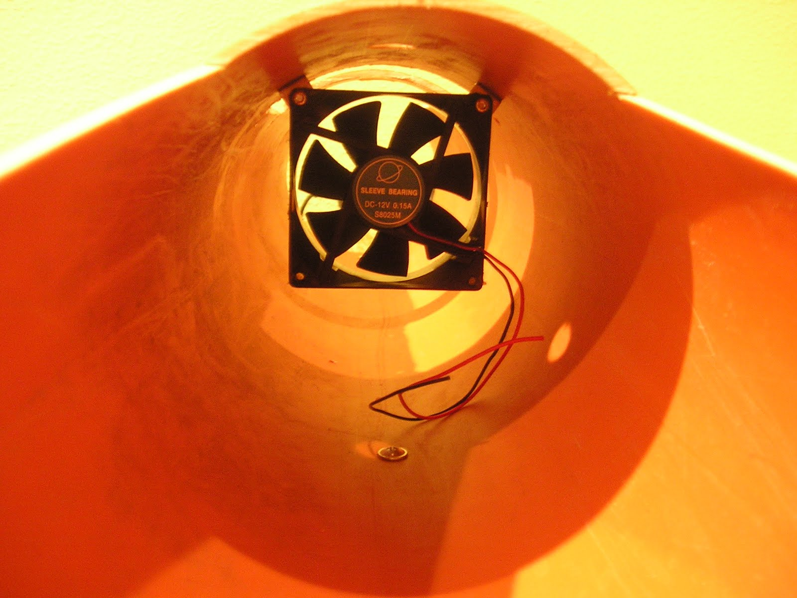
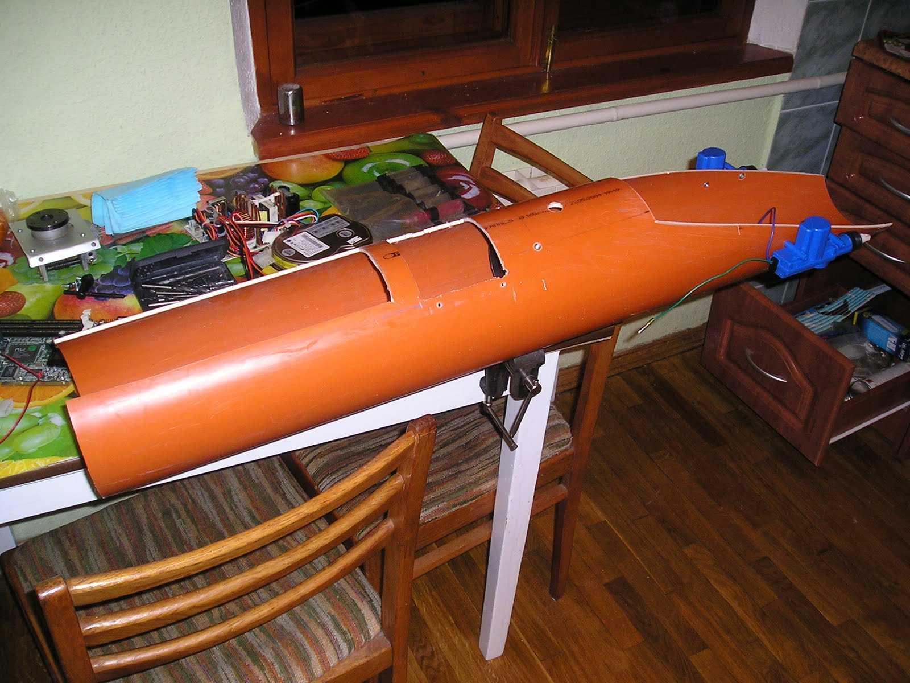
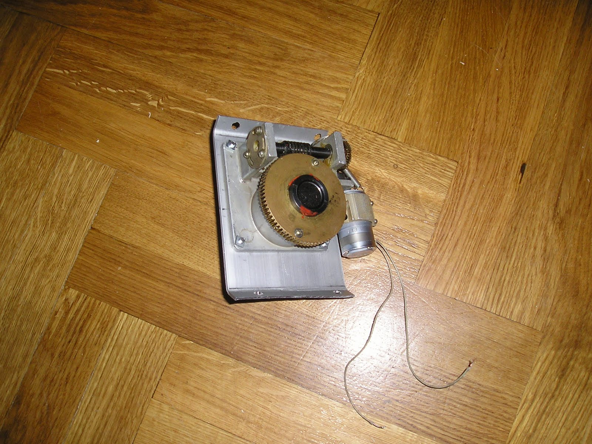
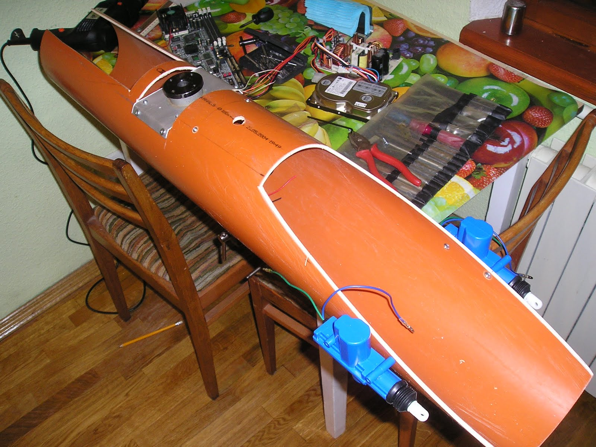
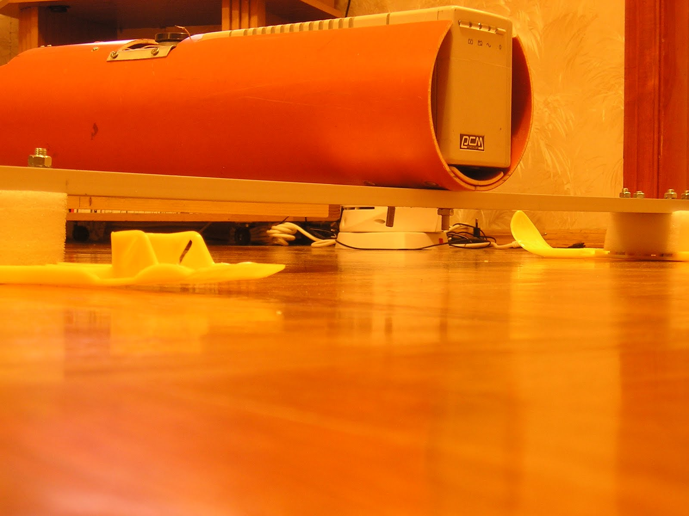

Итак в качестве основы корпуса использовалась пластиковая труба внутренним диаметром 120 мм.

Внутри трубы был установлен вентилятор для обеспечения циркуляции воздуха внутри корпуса и обдува таких горячих компонентов как блок питания и процессор.
Передняя часть корпуса была срезана для формирования заостренной формы носовой части, в которой будет находится одноплатный промышленный компьютер на базе чипсета ALI100 и CPU AMD K6-500.

В средней части корпуса был установлен привод вращения мачты (или центрального лонжерона ) крыла. Ввиду больший сисловых нагрузок был выбран червячный редуктор с приводм от двигателя постоянного тока и питанием 24 В.

В качестве источника питания был выбран на редкость стандартный UPS на 600VA который (как показали дальнейшие испытания) давал достаточно энергиии для часа автономной работы всех компонентов робота.

