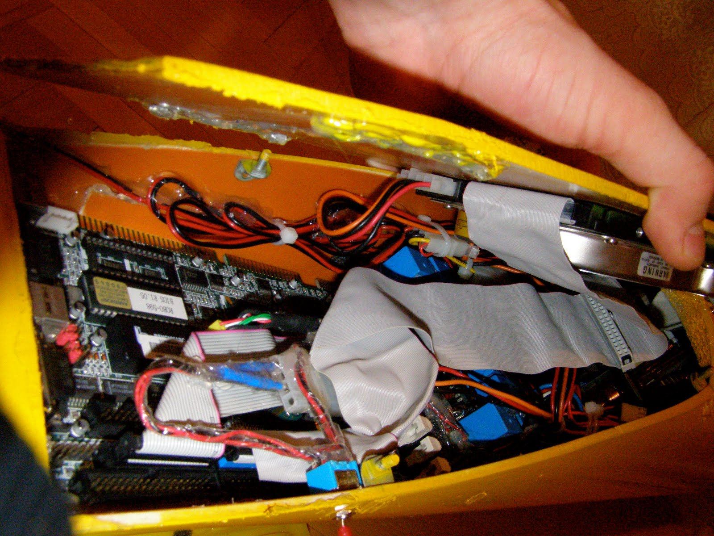
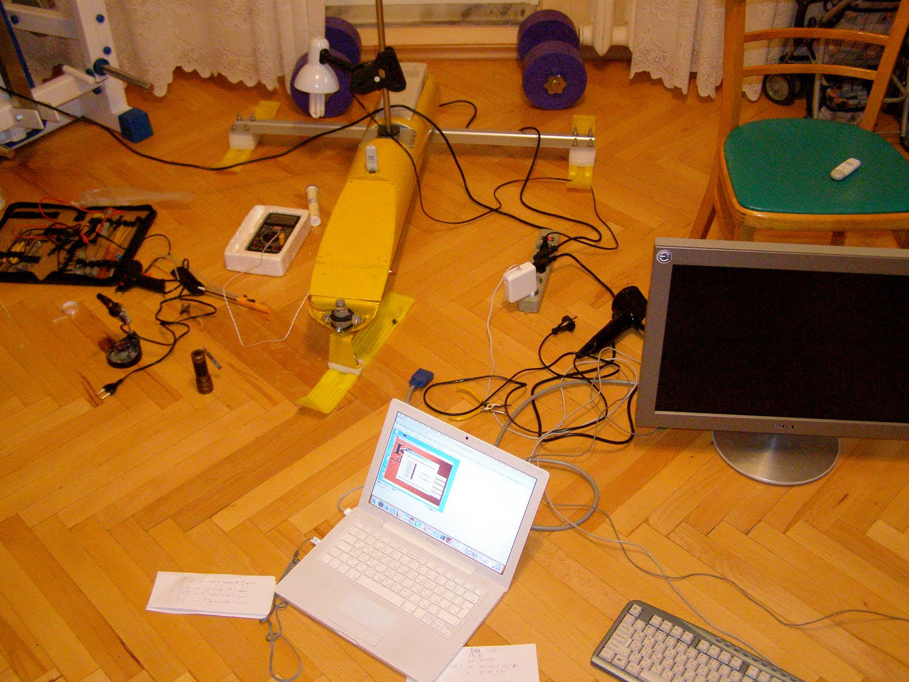
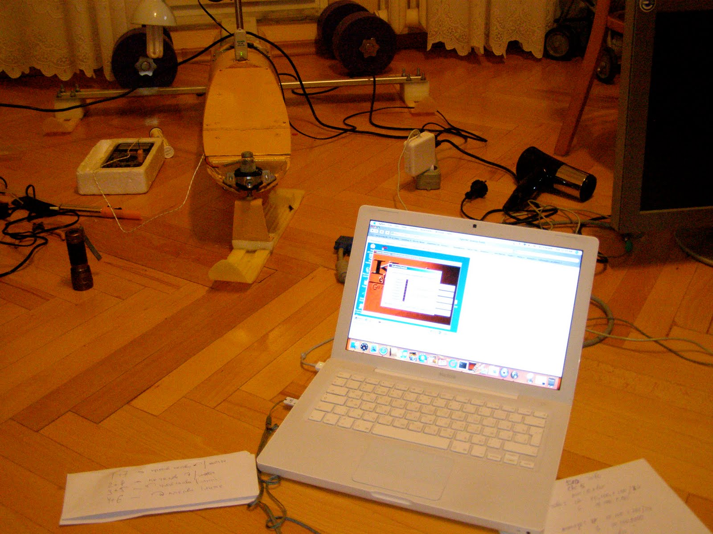
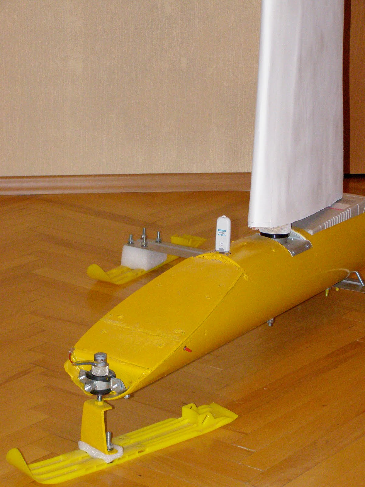
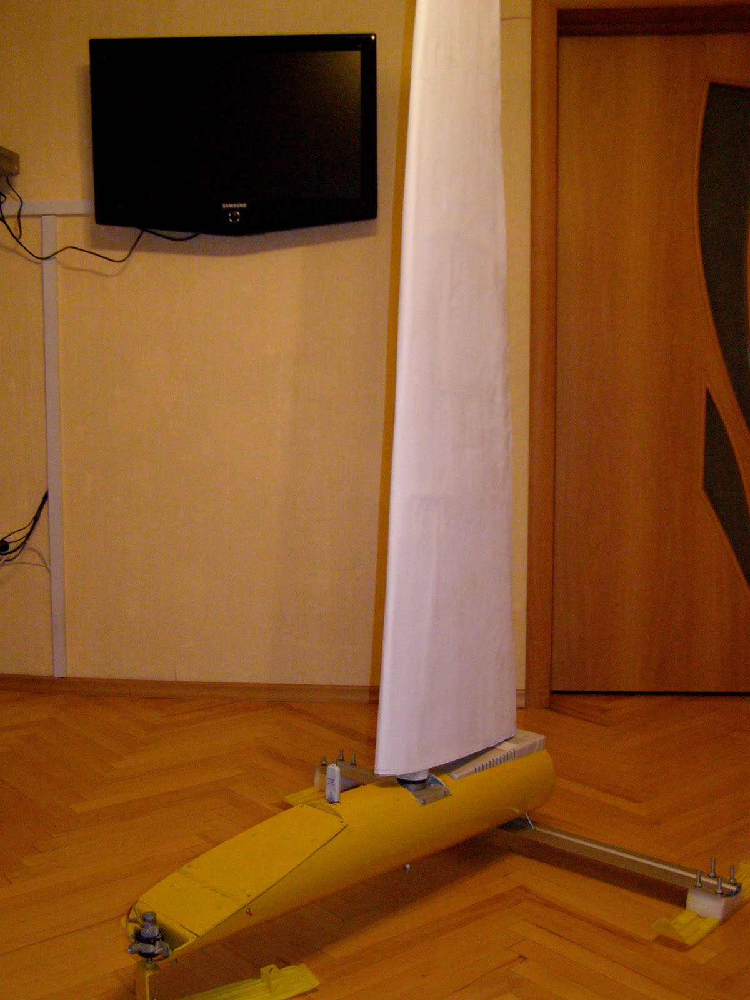

Итак подошло время финальной зборки.
На внутреннюю сторону крышки приборного отсека смонтирован жесткий диск.
На материнскую плату через изоляционную прокладку установлена плата управления сервомоторами и подключена к внутреннему разьему LPT порта. Кабели и платы были закреплены термоклеем. В процессе зборки пришлось здорово повозиться с феном , снимая этот клей при ошибках монтажа.

Панорамное :-) фото сборочной площадки.
Первоначально для отладки и тестирования компонентов монитор и клавиатура подключались напрямую к плате бортового компьютера.

Ввиду неудобства подобных подключений (соответствующие разъемы скрыты передней кромкой корпуса и для подключения необходимо частичное извлечения платы компьютера) для доступа к бортовому копьютеру использовался VNC через WiFi. 

Итак коротко о ПО робота. 
Операционная система : Windows 2000 - наличие необходимых драйверов и простота подключения USB WiFi и USB Web-Cam. (Хотя и не простой доступ к низкоуровневым функциям портов ввода-вывода)
Билиотека IO.dll для никоуровневой работы с портом.
Программа распознавания изображений (С++) для работы с web-camera (обнаружение препятствий по курсу)
Веб -сервер Apache
CGI программа связи веб-интерфейса робота иLPT порта(С++) . Фактически основной программный компонент робота где реализована вся логика движения и взаимодействия компонентов. 

Управление роботом осуществляеться через веб интерфейс заданием угла атаки паруса и направления движения. Все это фактически еще инженерные интерфейсы и по результатам ветровых и ходовых испытаний будут заменены автоматической системой управления парусом и избегания (обхода) пряпятствий. Единственными входными параметрами будут курс и скорость движения, а в идеале - траектория или район патрулирования.

Ну и напоследок готовое изделие "Робояхта" во всей своей красе.

Следующей публикацией начнуться описания испытаний, внесений изменений в конструкцию по их результатам и оптимизации программного обеспечения.
