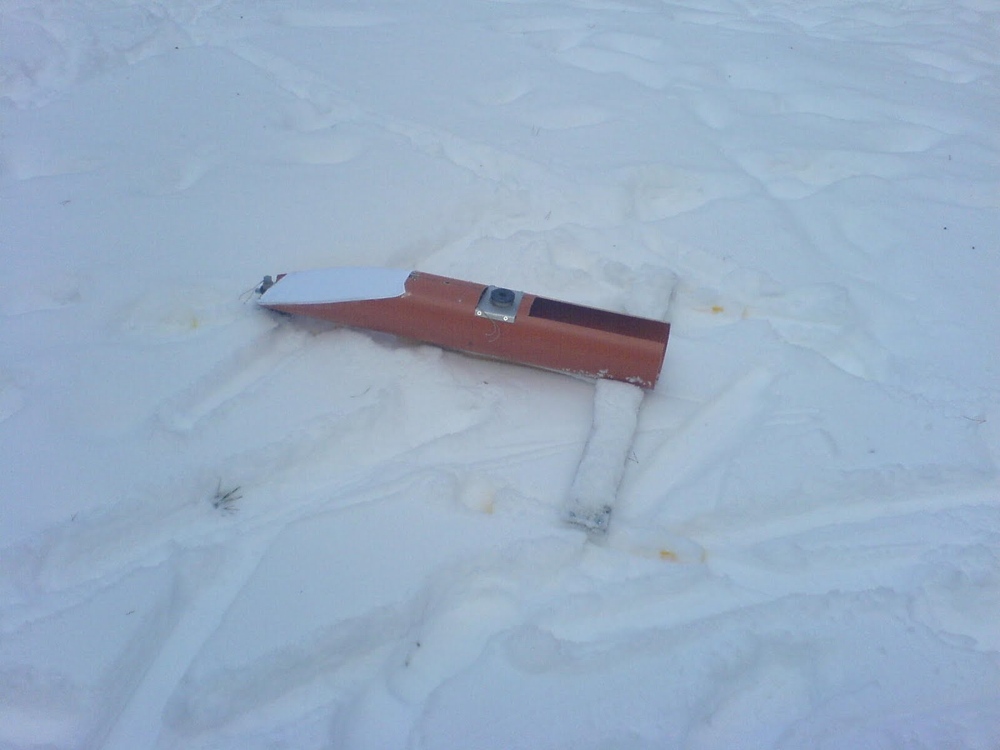
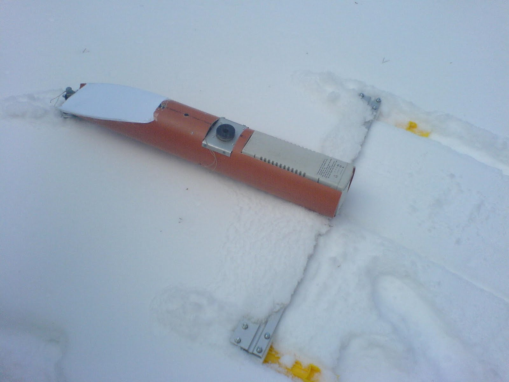
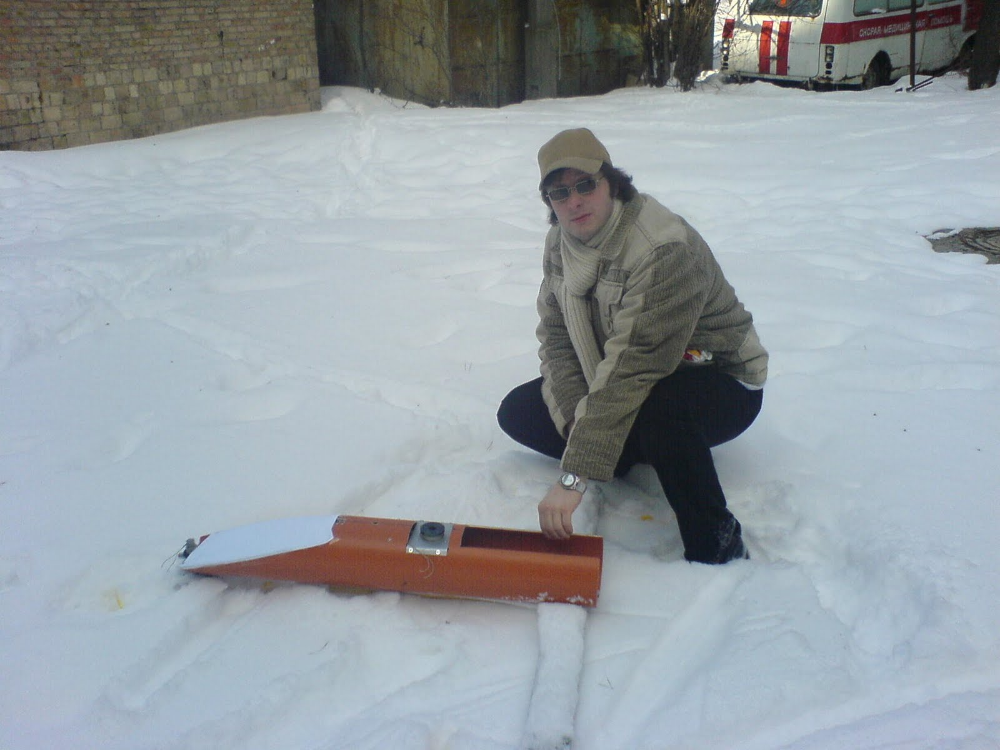

Итак теории теориями , а практических испытаний никто не отменял.
В один погожий и снежный денек решил (задолго до фнальной сборки) я проверить как же мой волшебный агрегат ходит по рыхлому снегу.

Результат как говориться на лицо:

Итак проходимость по рыхлому снегу и сопротивление движение ясно продемострировали, что для ходовых испытаний такая поверхность совершенно не годиться. Мало того, что аппарат даже без весовой нагрузки утопает в нем, так и двигаться вперед весьма и весьма непросто.

Было решено, что ходовые испытания делать либо на льду либо на укатанном и слежавшемся снежном насте. Кроме того в подошву лыж необходимо втроить лезвия для противодействия боковому сносу (скольжению) аппарата, получи этакий гибрид лыж и коньков.

Конструктор и его дитя. Испытание реальностью:

