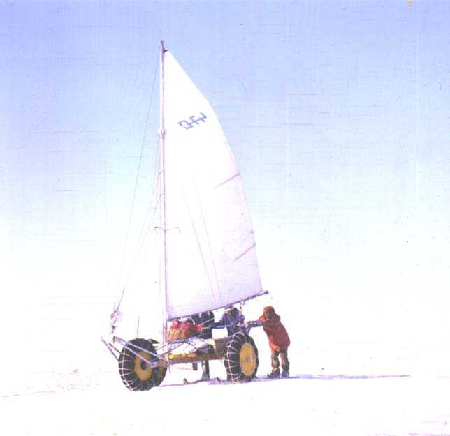
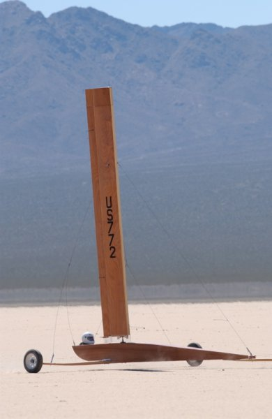
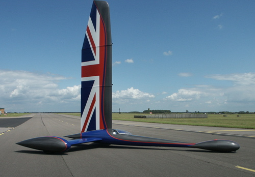
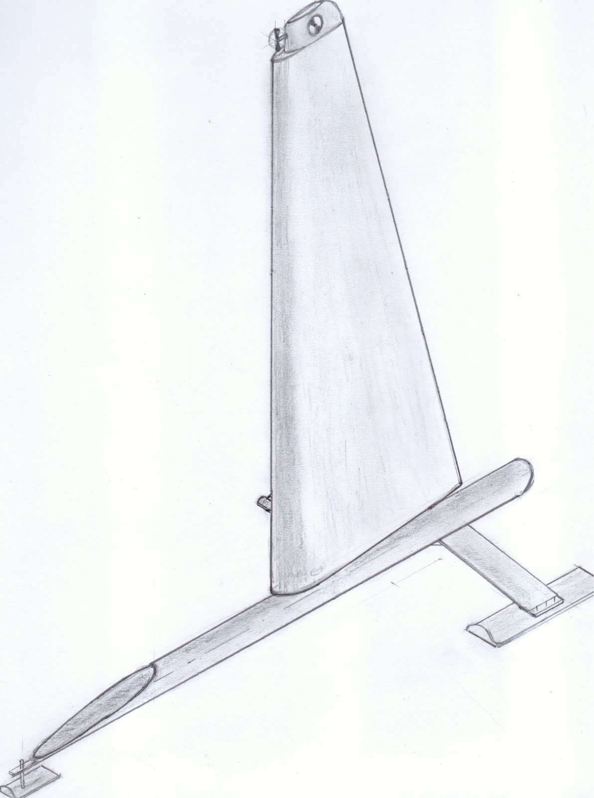
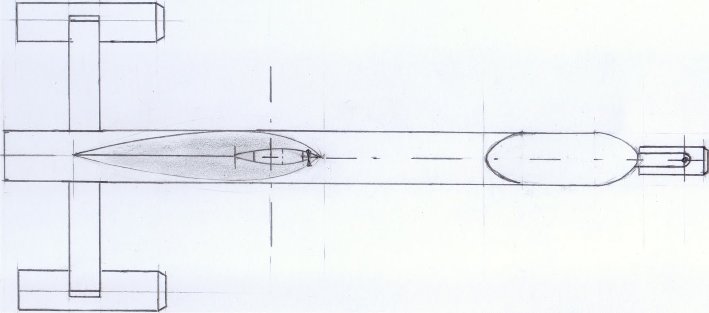
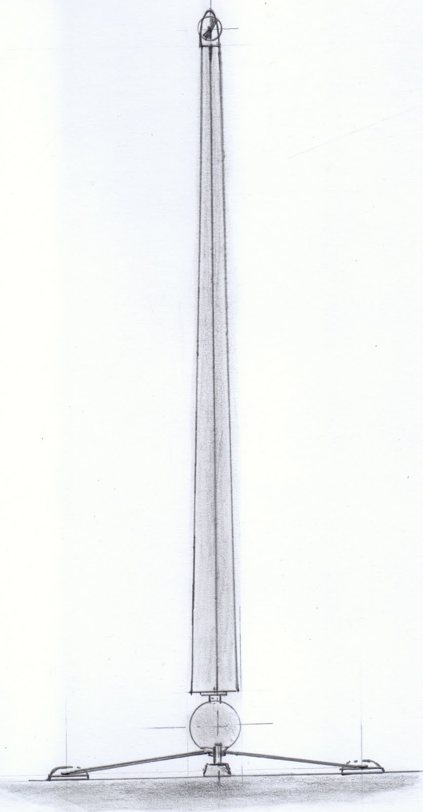
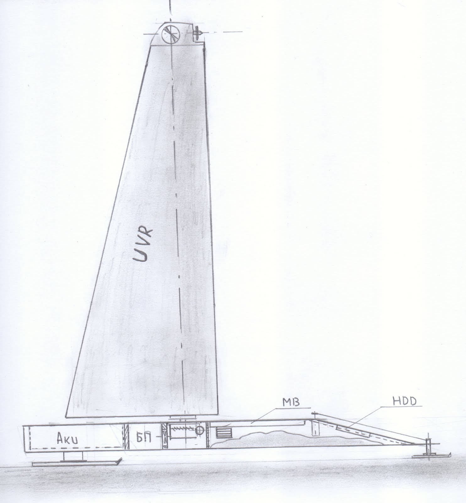

[← Back to all posts](../index.md)

After various (and sometimes unsuccessful) experiments with wheeled robots—which, frankly, were still a long way from true autonomy—I wanted to build a genuinely autonomous robot.
Autonomy in this case had to be as complete as possible:
1. **Motion autonomy**
2. **Power autonomy**
3. **Control system autonomy** (simply put, an onboard CPU)

Given the lack of high-capacity batteries capable of providing long-endurance propulsion—and in keeping with the growing trend toward green, energy-saving technologies—I decided to apply renewable energy to robotics.
Specifically, the robot would be propelled by the wind. The battery would only need to power the control servos and the onboard computer.
A trimaran equipped with a rigid wing sail was chosen as the prototype design.
For the first phase, I decided not to waste time and nerves on waterproofing a floating hull, choosing instead a close land/ice equivalent as a first approximation: an ice/land yacht (buer).

The first layout sketches produced this beauty:

---

[← Back to all posts](../index.md)
