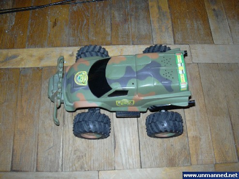
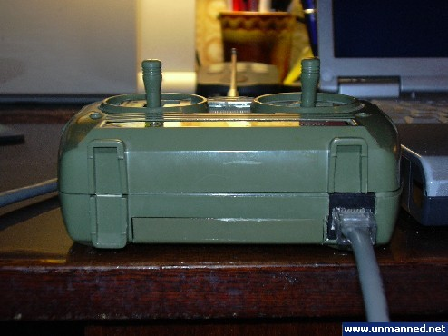
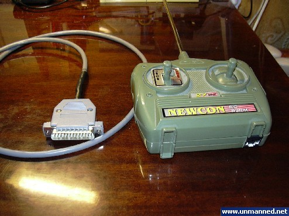
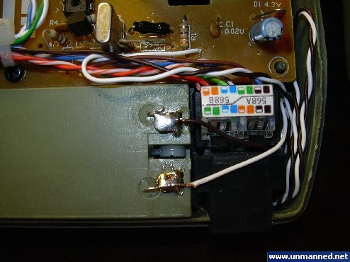
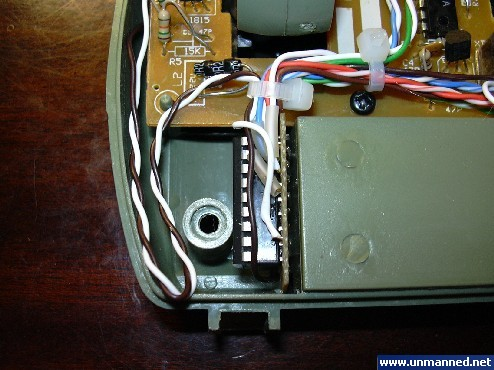
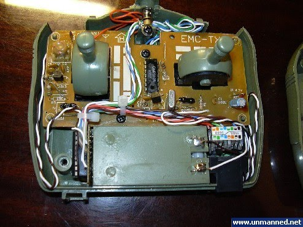
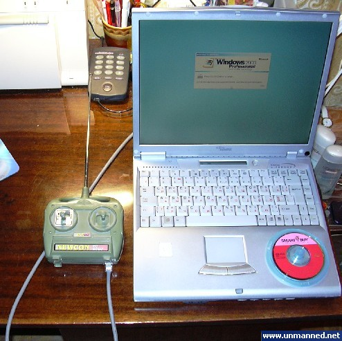
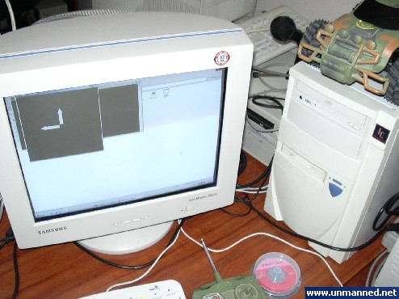
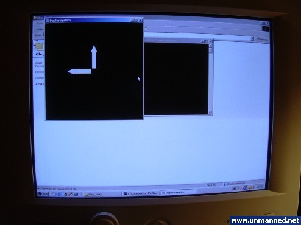
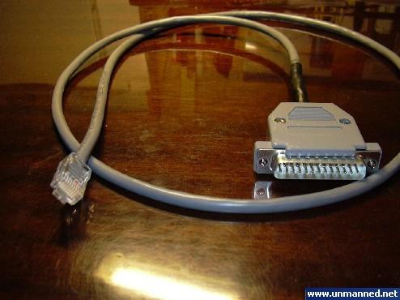

*All the material below was originally written around 2004 and is posted here as backstory.*

##### Variant 1: Integrated Remote Control

For this version, a Chinese no-name radio-controlled toy car was used as the base.

Only the toy's handheld remote control needed modification. I embedded the port driver IC inside the remote and wired it to the remote's directional control contacts. To keep the design modular, an RJ-45 jack was integrated into the remote housing to interface with the computer. This avoided having a permanently attached cable dragging behind the remote—the LPT-to-RJ-45 cable could simply be plugged in whenever PC control was needed.

The circuit is powered by the remote's stock battery. The driver IC and RJ-45 jack were tucked into the empty spaces inside the remote shell around the battery compartment.

To connect it to the PC, a custom LPT-to-RJ-45 cable was built, enabling hot-plugging between the remote control and the computer.

The control program was mapped to the standard keyboard arrow keys, making it possible to drive the car directly from the PC keyboard.

Testing of the resulting hybrid robot went great. The car responded reliably to commands, and everyone who drove it had a blast. Tests were conducted using both a laptop and a desktop PC.

These tests whetted my appetite for the project, and I decided to build an improved follow-up version.

The test runs were captured on video and are shown below:

<video controls width="320" height="240">
  <source src="../assets/videos/2009-10-04-variant-1-integrated-remote-control/video-1.mp4" type="video/mp4">
</video>

<video controls width="320" height="240">
  <source src="../assets/videos/2009-10-04-variant-1-integrated-remote-control/video-2.mp4" type="video/mp4">
</video>
