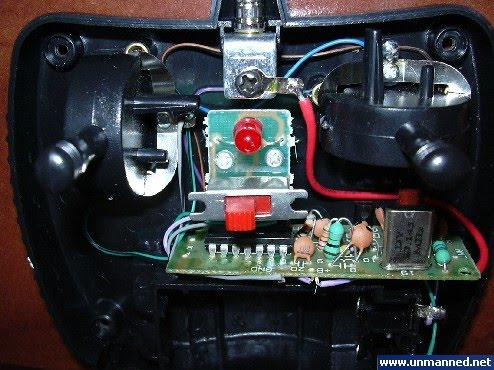
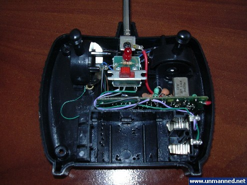
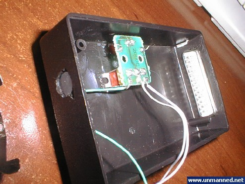
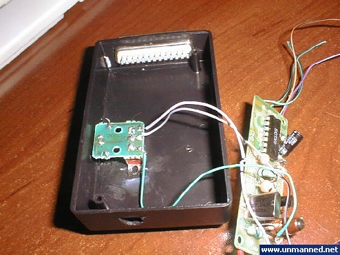
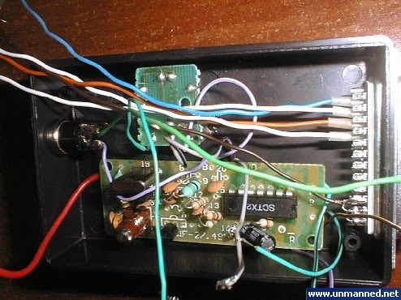
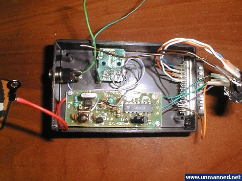
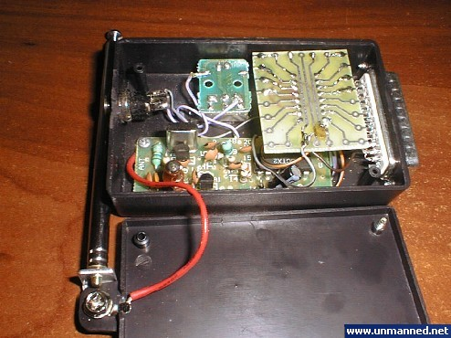
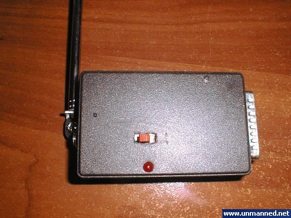
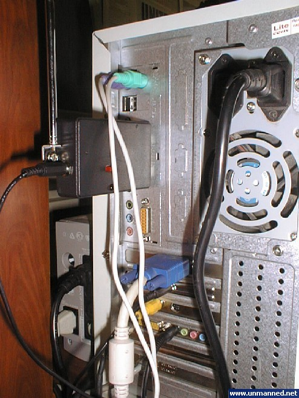

*All the material below was originally written around 2004 and is posted here as backstory.*

In this version of the robot, I decided to integrate the radio control transmitter directly onto the LPT port connector itself, similar to a hardware HASP dongle. Once again, a classic Chinese no-name radio-controlled toy car was used as the base. Its remote control transmitter operated on the same frequency as the previous model and used compatible command signals, making it possible to control both cars with a single unit. The remote control was disassembled, and the transmitter board was carefully extracted.

Next, I found the smallest possible enclosure suitable for plugging directly into an LPT port. The transmitter board, with modified control and power circuits, was mounted inside.

The stock power source (a 9V battery) was replaced with direct power from the PC's power supply. For this, a custom power cable with a standard PC Molex connector was routed out of the PC case through a modified expansion slot bracket.

An LPT connector, power toggle switch, and status LED were installed in the enclosure, allowing the transmitter to be switched on at any time while the computer is running.

The driver IC (`ULN2803A`) and its supporting components were mounted on a board and wired to the LPT connector and the command inputs of the radio transmitter.

All that remained was to mount the antenna, and the LPT radio transmitter was complete:

Testing showed how easy it was to plug into any PC case, as well as its compactness and convenience when operating both RC car models.

No software changes were needed at this stage, as the existing control program was fully compatible with both transmitter variants.
The next step in evolving this setup was mounting a video camera onto the vehicle.
