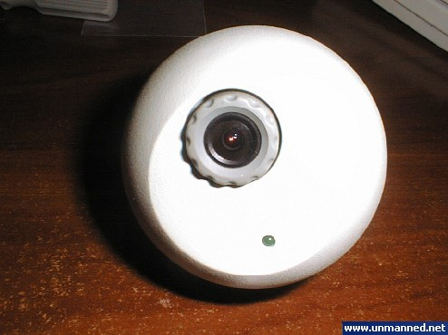
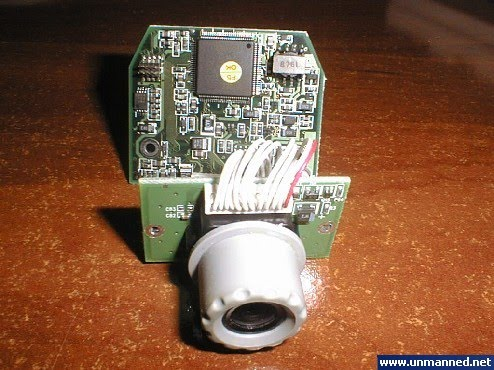
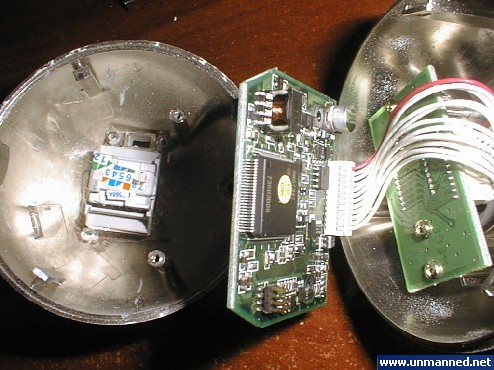
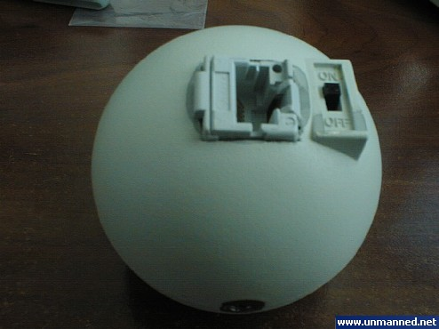
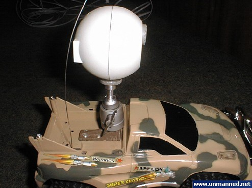
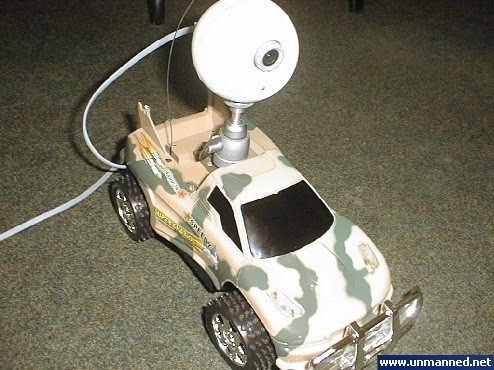
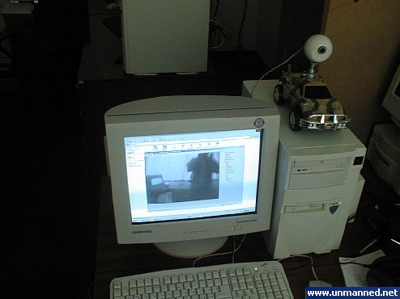
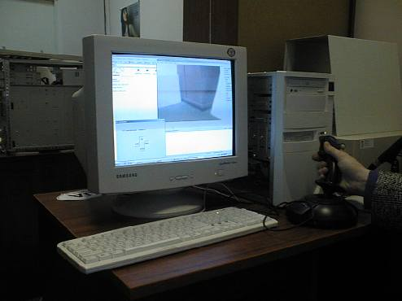

[← Back to all posts](../index.md)

To achieve autonomy with these prototypes, I needed to write image-processing and self-navigation software.
That required a test robot with a high degree of mobility and the ability to transmit video from an adjustable onboard camera. A standard USB webcam couldn't be used due to USB cable length limits.
Accordingly, I decided to use an analog color PAL camera paired with a video capture card installed in the host PC. I selected a videoconferencing kit consisting of a PAL camera and a BT848-based PCI video capture card. To keep the architecture modular, the camera was modified by replacing its fixed cord with an RJ-45 jack integrated directly into the camera housing.

Four lines run from the camera to the video capture card: two for power and two for the composite video signal. A 10-meter 4-wire telephone cable was chosen as a test tether. Although it introduced slight image degradation, it gave the robot car plenty of freedom to move around.

The RC car chassis was modified to mount a standard camera tripod head, allowing easy adjustment of the camera's pitch and yaw angles on the vehicle. This resulted in the following setup:

The trials went quite well and yielded valuable insights regarding camera mounting angles, lighting conditions, and the need for additional sensors.

The control software was updated to capture live video and overlay directional arrows on the screen indicating the robot's movement.
I also decided to add joystick support to the control software.
Development of an automatic orientation and fiducial object-recognition system was started to achieve full autonomy, with Variant 3 serving as the primary testbed.

New control software supporting both joystick and keyboard input was also completed:

---

[← Back to all posts](../index.md)
