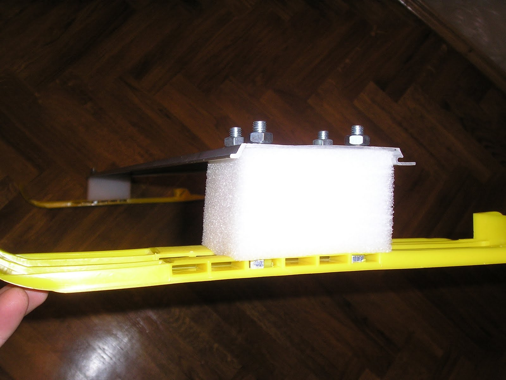
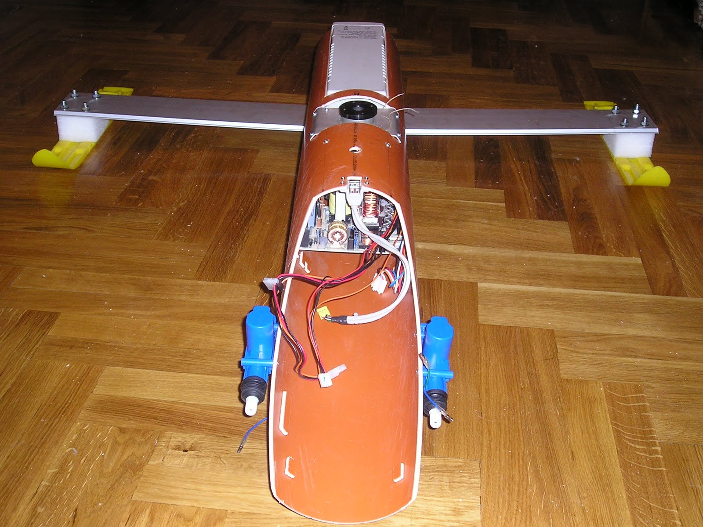
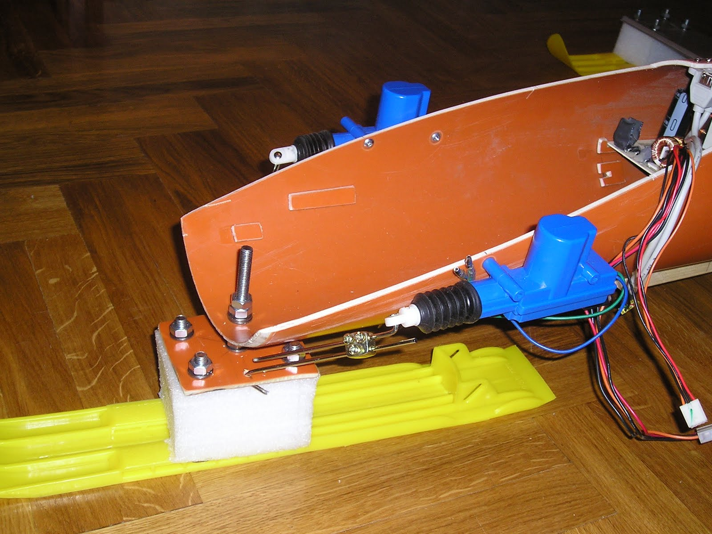
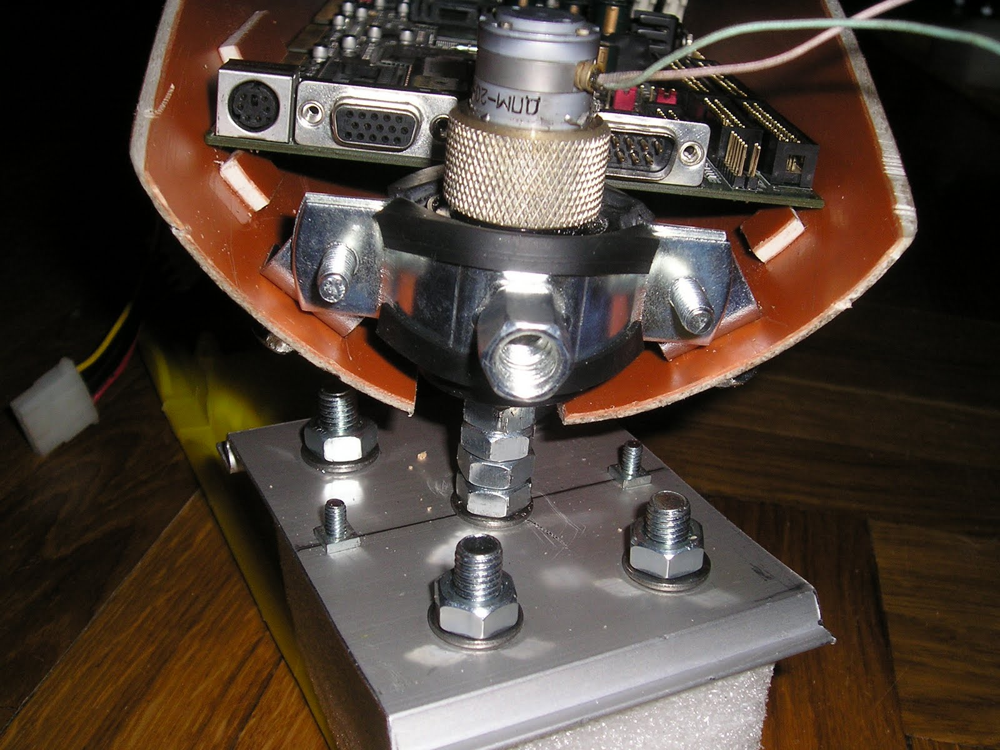
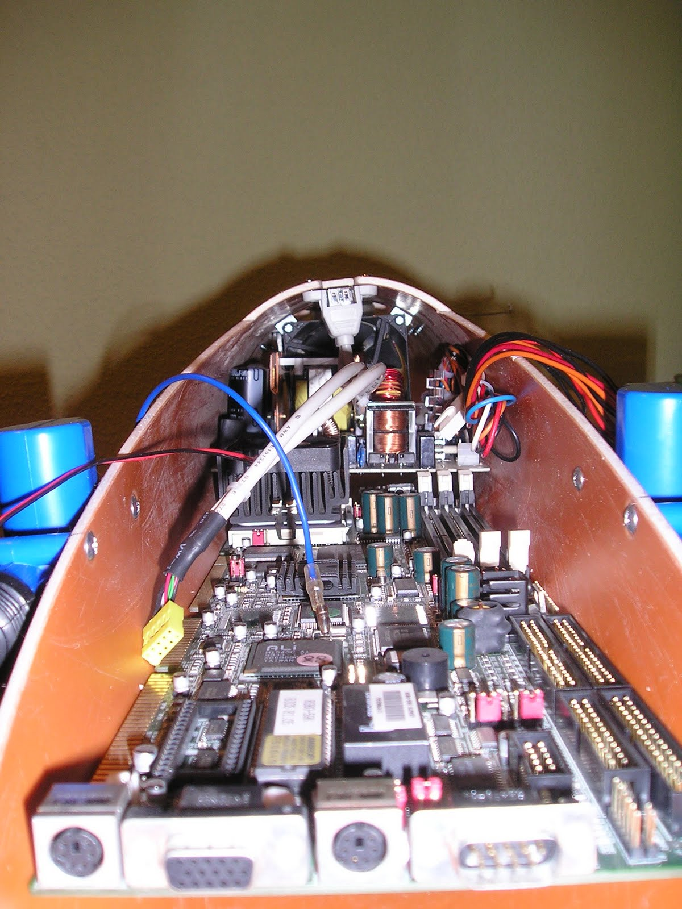

[← Back to all posts](../index.md)

To keep the land/ice yacht experiment simple, standard plastic skis were used, attached to a duralumin crossbeam through extruded polystyrene foam blocks.
The foam block acts as a shock absorber to smooth out surface bumps and allows the ski to pivot slightly in the horizontal plane when hitting an obstacle.

In the photo below, you can clearly see the deflection of the original crossbeam, which is why it was subsequently replaced with a stiffer box-section beam.

Initially, two linear actuators (automotive central-locking solenoids) were considered for steering, but experiments and calculations showed that they provided insufficient steering angle for the front ski, too little force, and no way to set the steering angle accurately.

The optimal solution turned out to be mounting an electric motor with a planetary gearbox directly on the vertical pivot axis of the front ski. This gave the ski both wide steering range and high torque on the shaft (though it introduced a still-unresolved issue: the shaft pin shearing off if the ski hits a hard obstacle).

Below is a view of the front section of the hull housing the onboard computer and the power supply (located behind the computer, right in front of the cooling fan).

I will cover the electrical and electronic internals of the vehicle in upcoming posts.

---

[← Back to all posts](../index.md)
