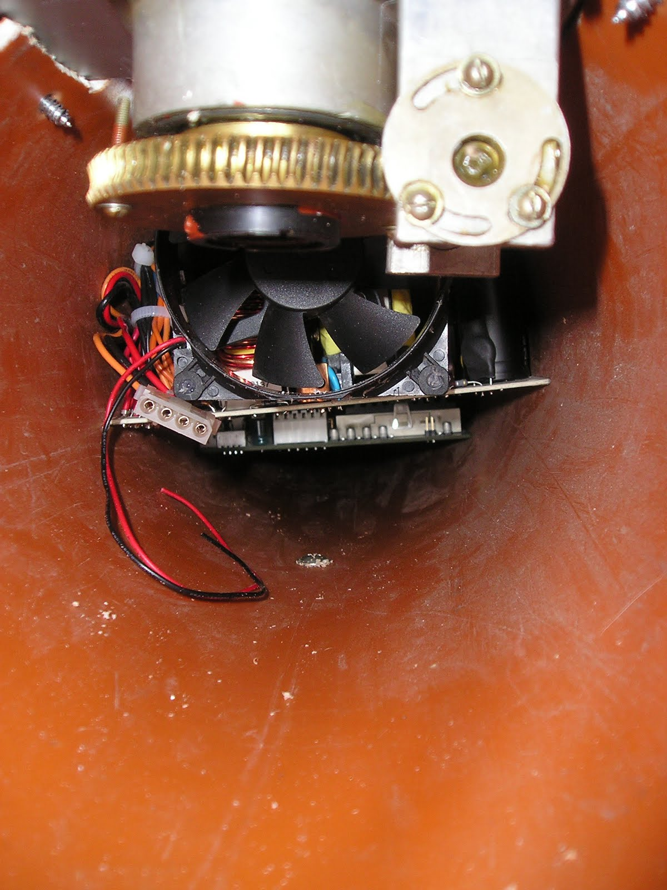
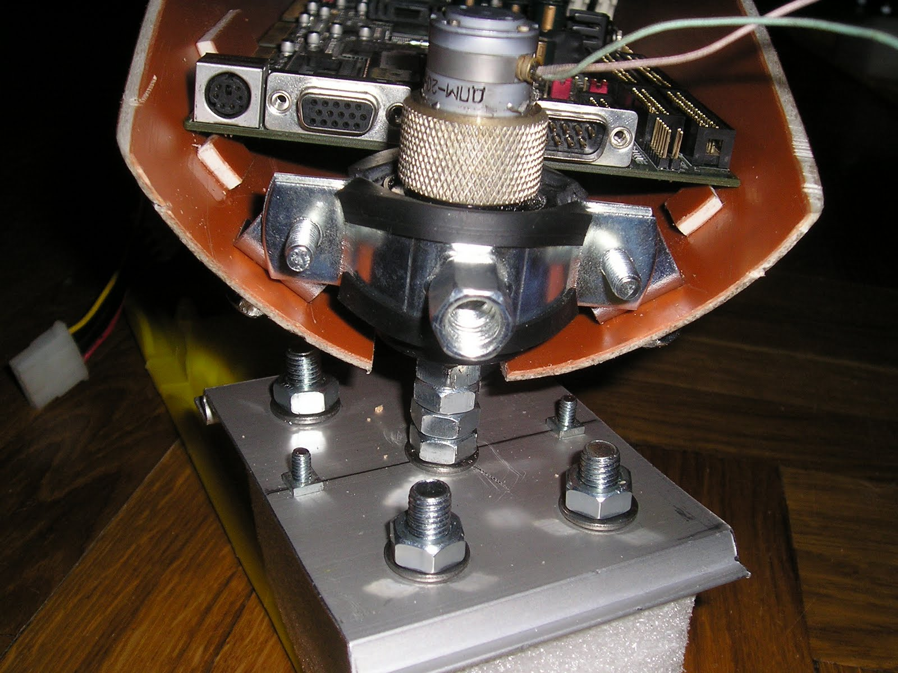
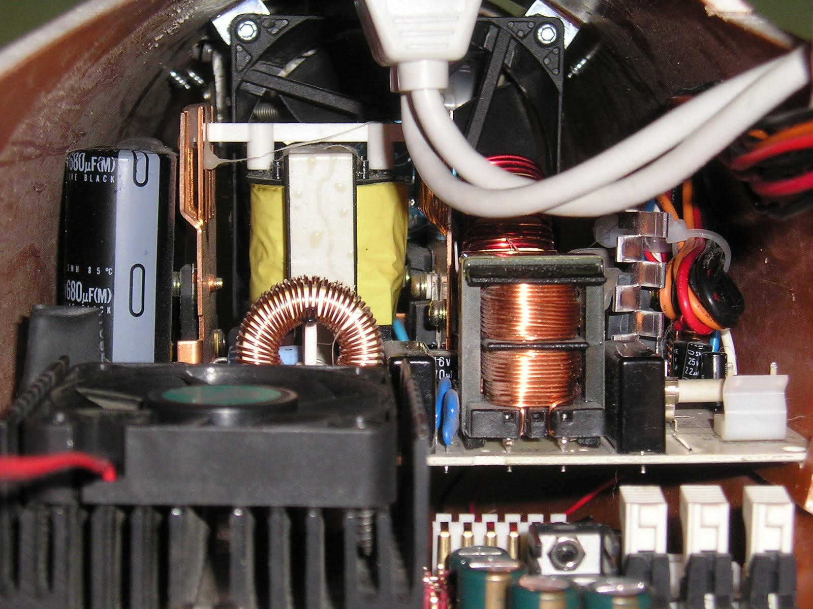
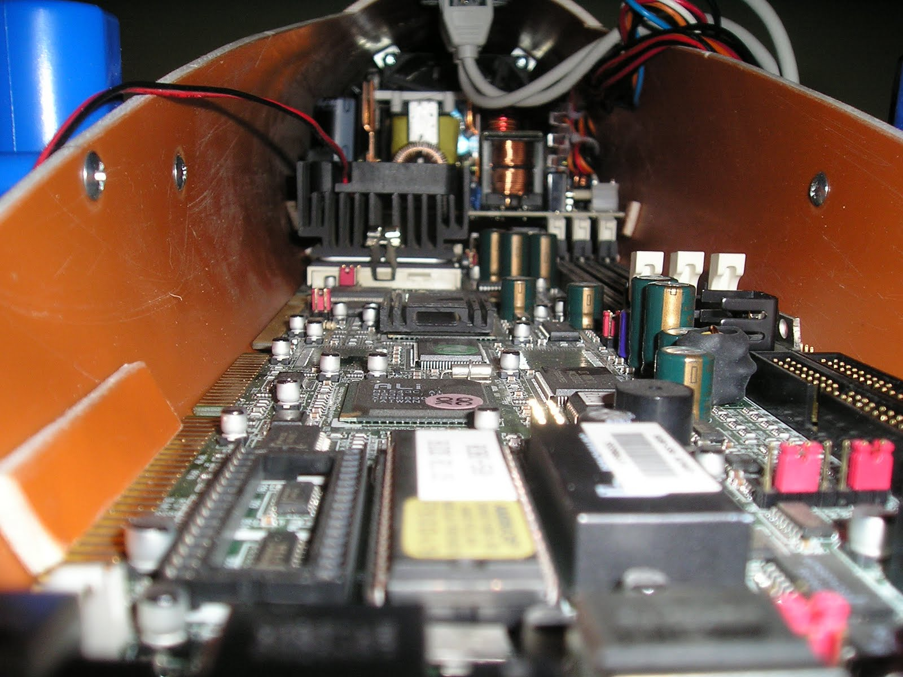
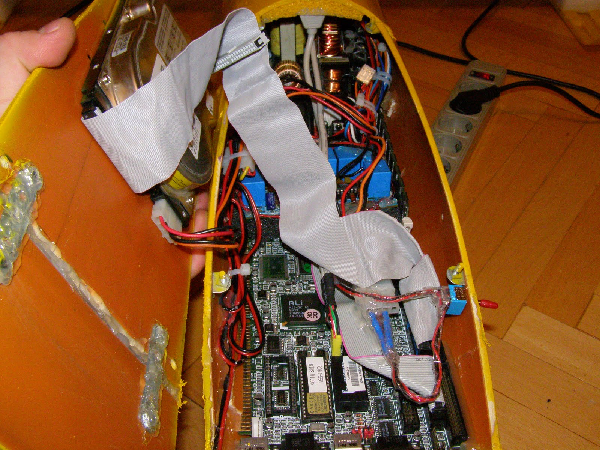

[← Back to all posts](../index.md)

A few words about the robot's electronic internals:

The robot uses two compact electric drives: one to adjust the angle of attack of the wing sail, and another to steer the front ski.

The wing-sail angle-of-attack drive consists of a 24V DC motor and a reversible worm gearbox. This servo drive also serves as an intermediate bearing for the wing-sail shaft, while its rotating support ring takes part of the vertical load from the sail and engages with the sail's base plate.

The front ski steering drive has lower power and runs on 12V. It uses an inline planetary gearbox mounted directly on the motor shaft.

All of this hardware is powered by a standard AT computer power supply, which in turn draws power from a standard 600VA UPS. Unfortunately, this setup involves redundant power conversion: 220V wall outlet → UPS battery charger → 12V battery → inverter back to 220V AC → AT power supply → onboard DC rails (-12V, +12V, +5V, -5V, +3.3V). Why do it this way? Generating all those required voltage rails directly from 12V DC would require several custom DC-DC converters that are hard to source and pointless to build from scratch for a test prototype (where weight is not yet a critical factor).

Mounted further forward in the hull is a ROBO industrial single-board computer based on the ALi M1541 (Aladdin V) chipset with an AMD K6-500 CPU and 256 MB of RAM.

The controller for both servo motors is connected to the onboard LPT header, while two USB 1.0 ports are routed to the exterior of the hull for the Wi-Fi adapter and webcam.

A 6 GB IDE hard drive is mounted on the inner side of the computer compartment cover.

In the next post: the wing-sail construction.

---

[← Back to all posts](../index.md)
