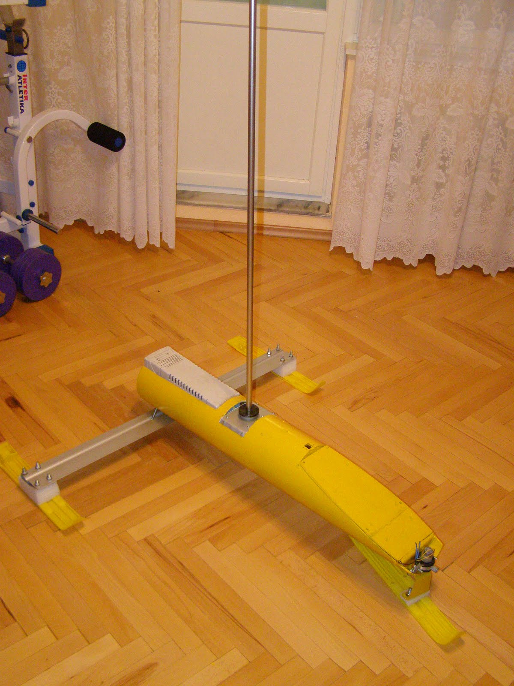
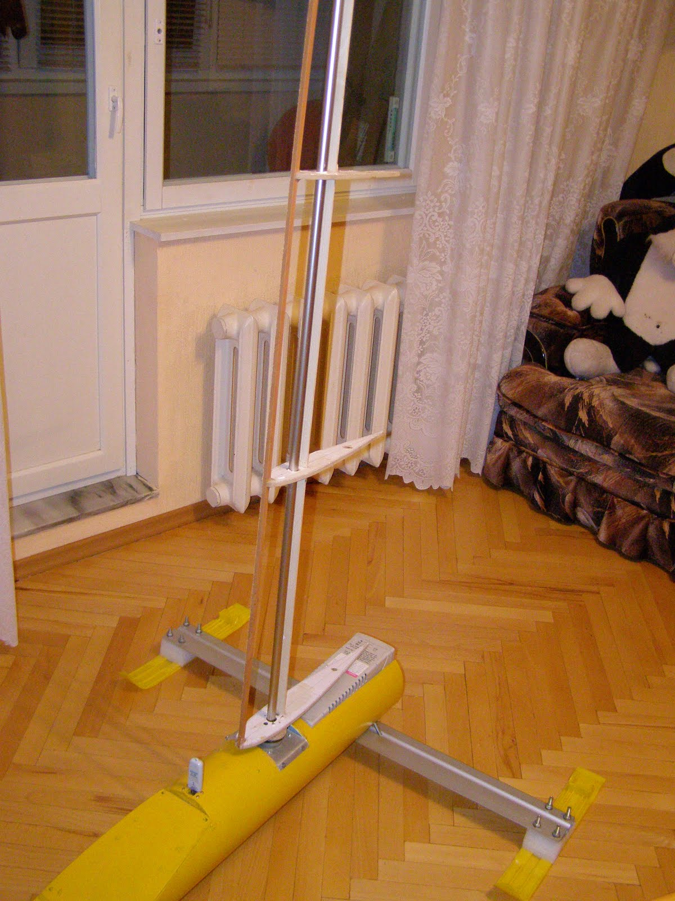
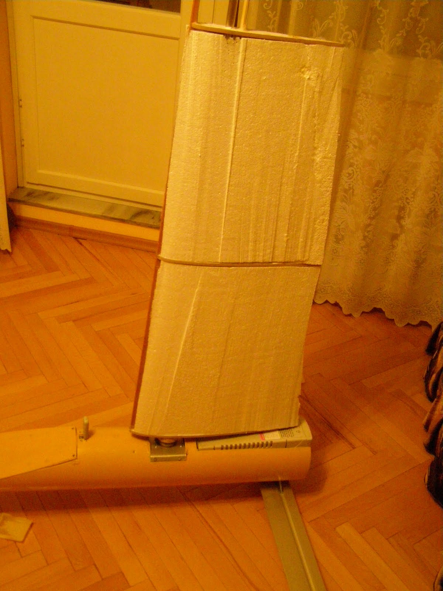
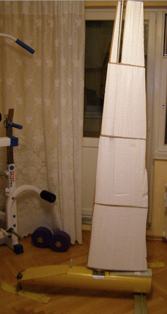
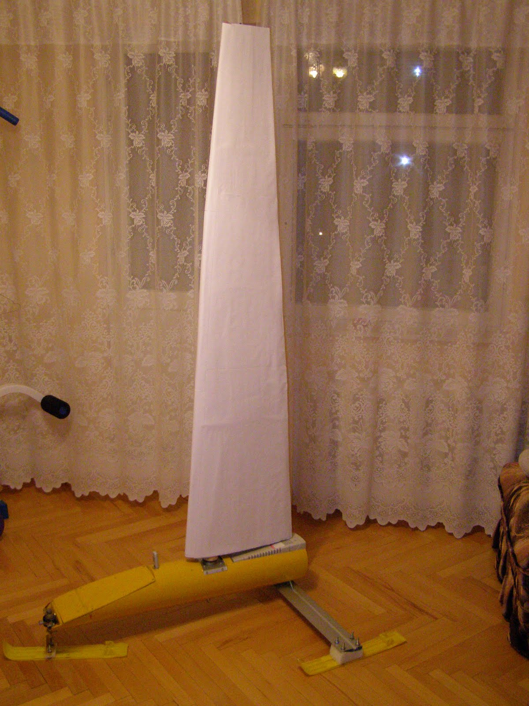

[← Back to all posts](../index.md)

One of the most important components of the robot—specifically, its propulsion unit—is the wing sail. Its structure combines elements of both a traditional sail and an aircraft wing. To provide the necessary strength, the mast is a steel tube that also acts as the main spar in the wing structure. Initially, the plan was to keep the mast fixed and let the wing sail rotate around it as an axle. However, to reduce weight, simplify the design, and make disassembly easier for transport, the wing was rigidly attached to the mast. This required installing a mast partner/step (lower mast support) with an integrated bearing sleeve inside the hull.

The vertical load, however, is borne by the drive gearbox support, which engages with the wing's base pad via pins. The lower mast bearing primarily handles the bending loads of the mast.

The structural frame of the wing consists of 5 ribs, a leading-edge stringer shaping the nose profile, and an additional flat central spar parallel to the mast to reinforce torsional rigidity.

The wing core itself is made from foam blocks fitted between the ribs and glued to both the ribs and spars. The foam blocks were shaped using a hot nichrome wire cutter.

Surface irregularities and imperfections in the foam were filled with sealant.

Heavy drawing paper (Whatman paper) impregnated with polymer resin was used for the outer skin. To improve water resistance, the wing was finished with white water-repellent paint.

---

[← Back to all posts](../index.md)
