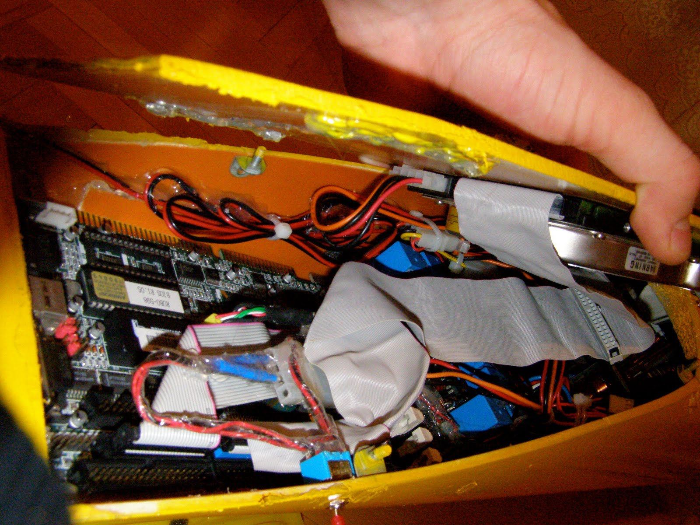
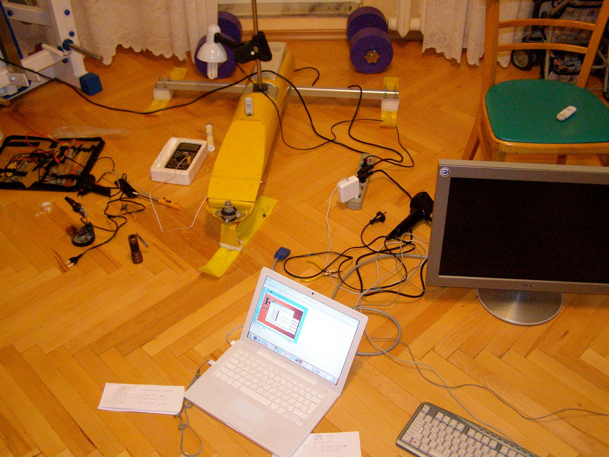
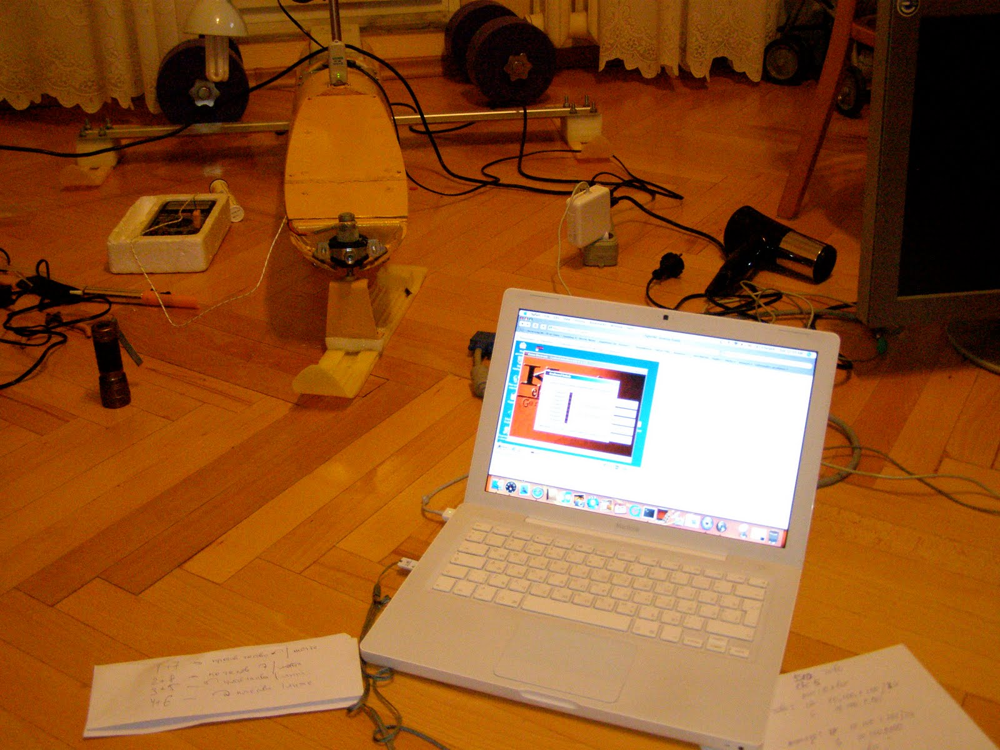
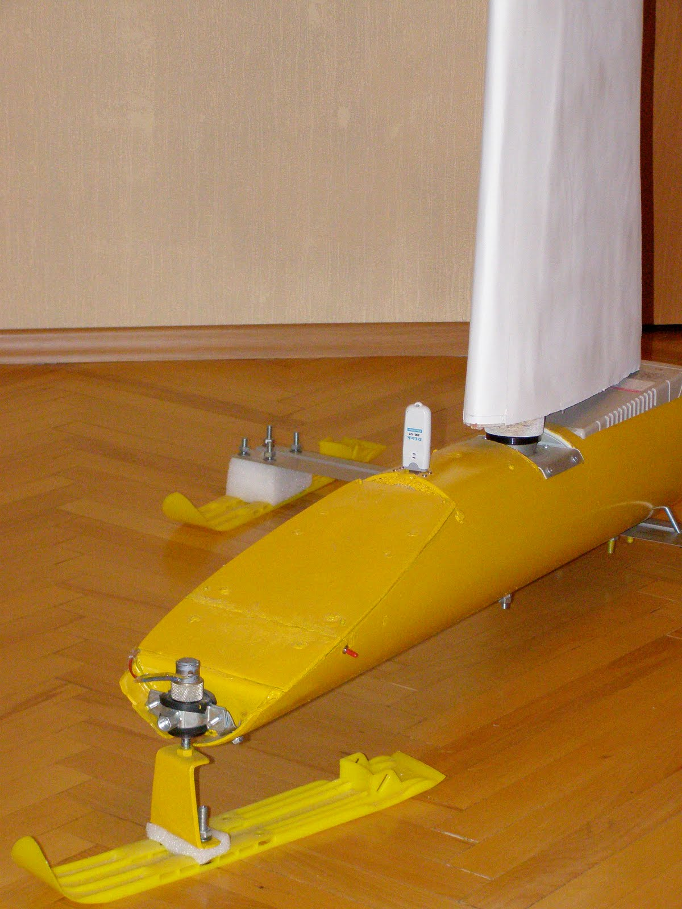
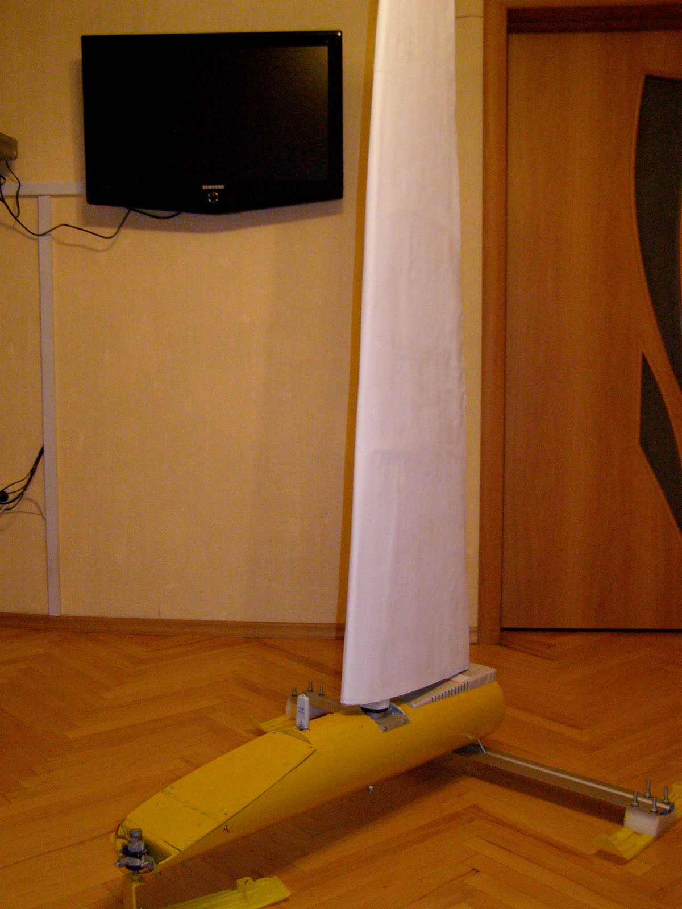

The time has come for final assembly.
The hard drive was mounted on the inside of the instrument compartment cover.
The servo controller board was mounted onto the motherboard over an insulating layer and connected to the internal LPT port header. Cables and boards were secured with hot glue. During assembly, I had to spend quite a bit of time with a heat gun removing that glue whenever wiring mistakes needed fixing.

A panoramic :-) photo of the assembly workbench.
Initially, for component debugging and testing, a monitor and keyboard were connected directly to the onboard computer board.

Because direct connections were inconvenient (the ports are tucked behind the front edge of the hull, requiring partial extraction of the computer board to plug anything in), VNC over Wi-Fi was used to access the onboard computer.

Here is a brief overview of the robot's software stack:
- **Operating System**: Windows 2000 — chosen for driver availability and easy plug-and-play support for the USB Wi-Fi adapter and USB webcam (despite the added complexity of accessing low-level I/O port functions).
- **`IO.dll` library**: Used for low-level LPT port I/O access.
- **Image recognition program (C++)**: Processes frames from the webcam to detect obstacles ahead.
- **Apache Web Server**: Hosts the control interface.
- **CGI control program (C++)**: Bridges the web interface and the LPT port. This is effectively the core software component of the robot, implementing all motion logic and component coordination.

The robot is controlled via a web interface by setting the wing-sail angle of attack and the steering direction. Right now, these are engineering interfaces; following wind and field trials, they will be replaced by an automated sail-control and obstacle-avoidance system. Ultimately, the only input parameters will be heading and target speed—or ideally, a patrol trajectory or operating zone.

And finally, the finished "Roboyacht" in all its glory:

The next posts will cover field trials, design modifications based on test results, and software optimization.
