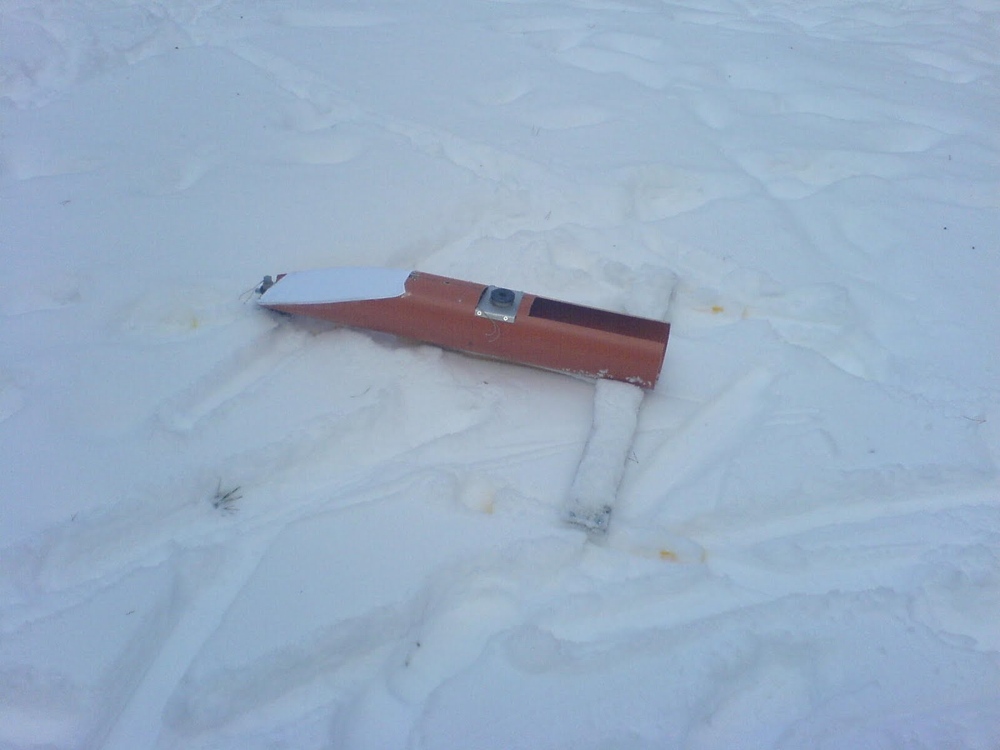
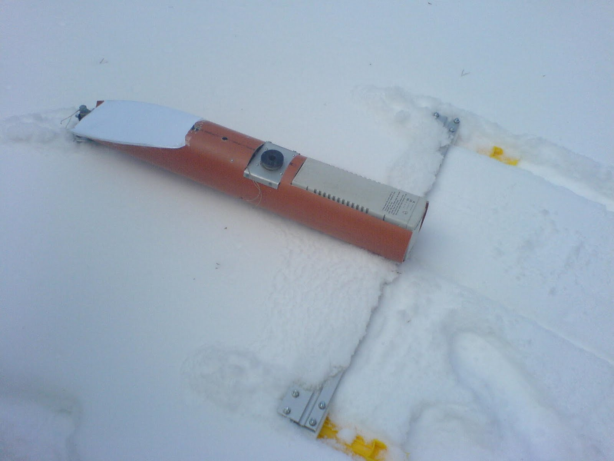
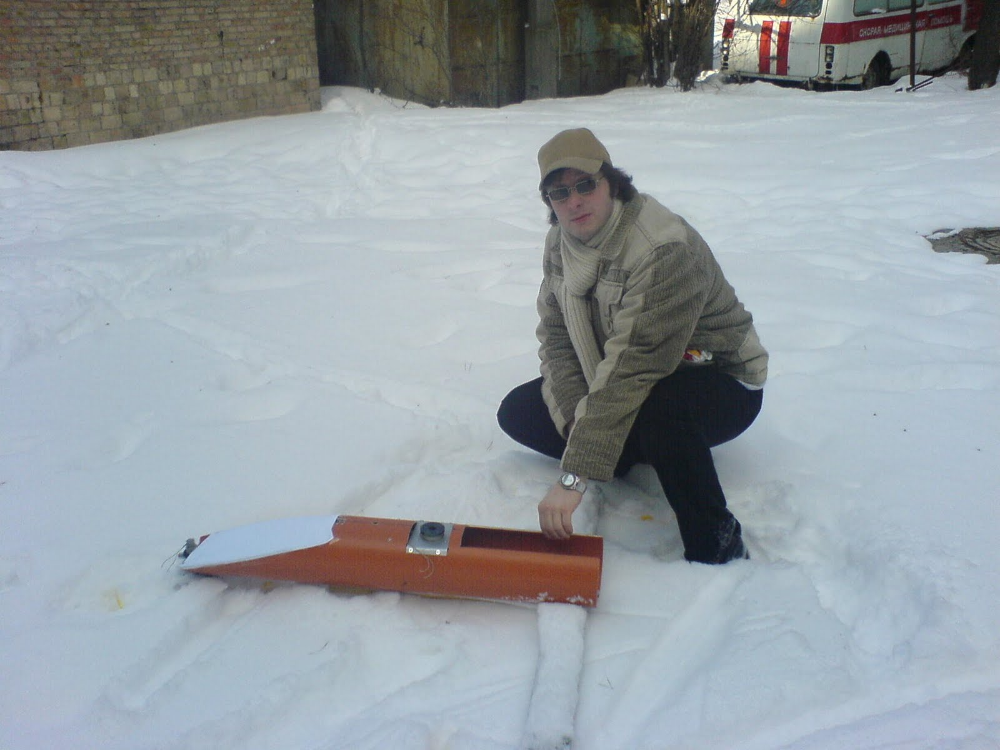

Theory is one thing, but there is no substitute for practical testing.
On a nice, snowy day (long before final assembly), I decided to test how my magical contraption handles loose snow.

The result speaks for itself:

The performance in loose snow and the high resistance to motion clearly demonstrated that such a surface is completely unsuitable for sea/field trials. Not only does the vehicle sink into the snow even without its full payload weight, but moving forward is also extremely difficult.

It was decided that future trials must be conducted either on ice or on hard-packed snow crust. Additionally, metal blades need to be built into the bottom of the skis to prevent lateral drift (sideways sliding), creating a hybrid between skis and ice skates.

The designer and his creation—tested by reality:

