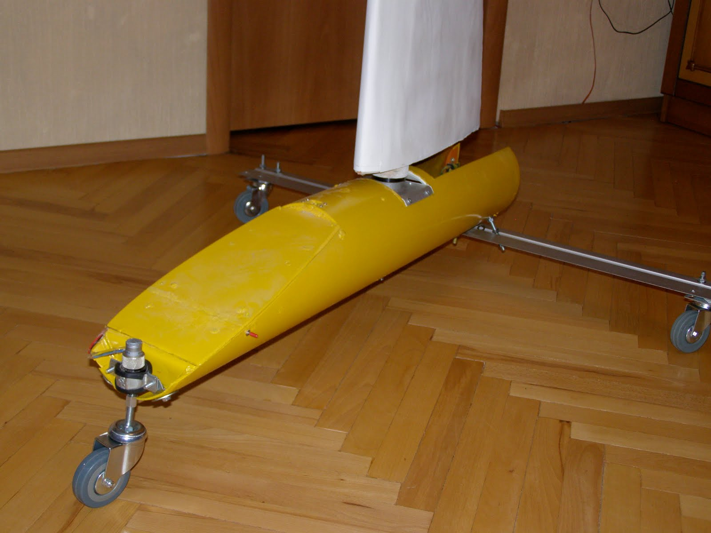
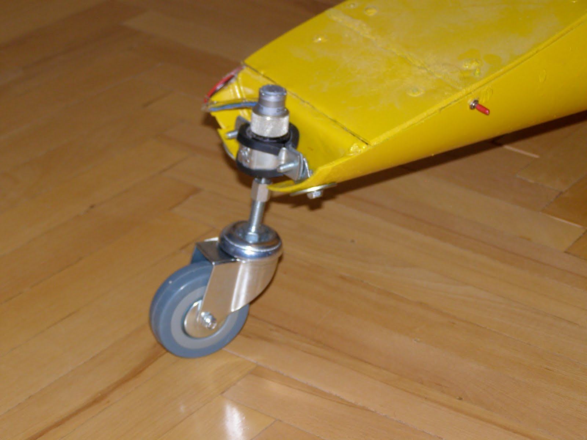
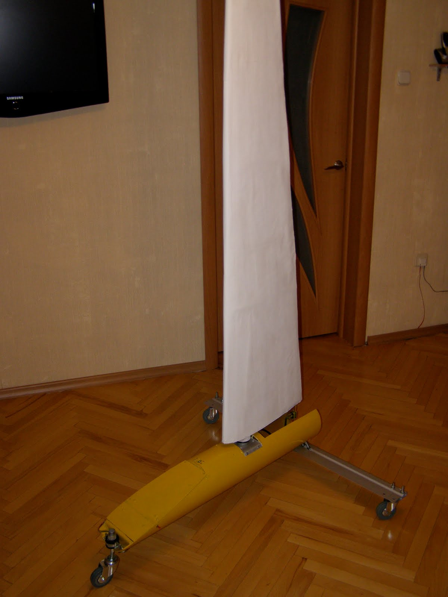

The time has come to fulfill the promise I made to myself.
The former trimaran now has wheels.

At the moment, the caster wheels are free-swiveling (to make it easier to roll around on the floor during debugging and storage), but they will be locked straight before the test runs.
Field trials will also show how much rolling friction the wheels have and whether the land yacht can move in light wind.

The only thing that worries me is the front wheel strut where it attaches to the gearbox shaft. Not only is the shaft itself short and barely 3 mm in diameter, but the offset caster design also creates a lever arm applying the robot's weight to the shaft, subjecting it to significant bending loads.

And the battery hasn't even been installed yet! Redesigning this assembly from scratch would take at least a month (given my current workload), and before I know it, winter would be back again. So for now, I'm going all-in: testing it as-is with my fingers crossed. If the shaft snaps, I'll figure out how to deal with it then.

