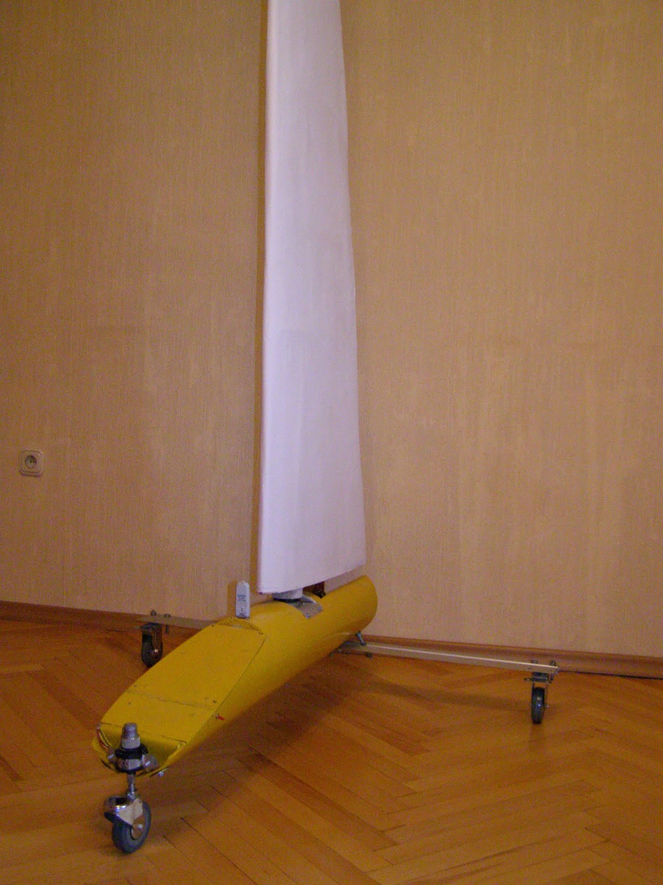
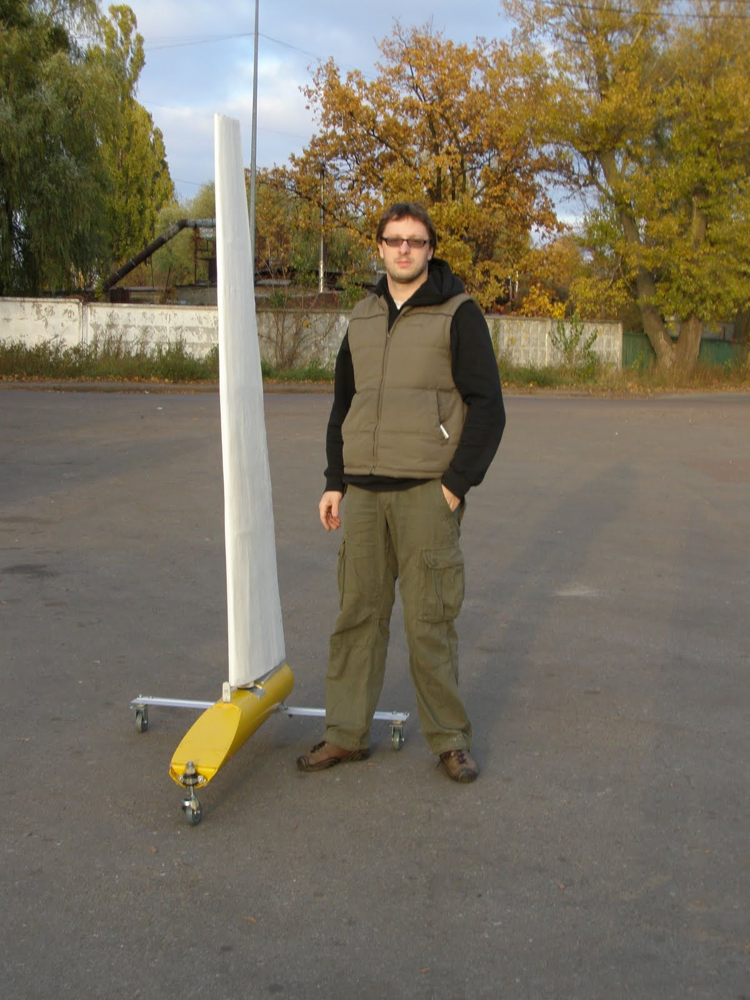
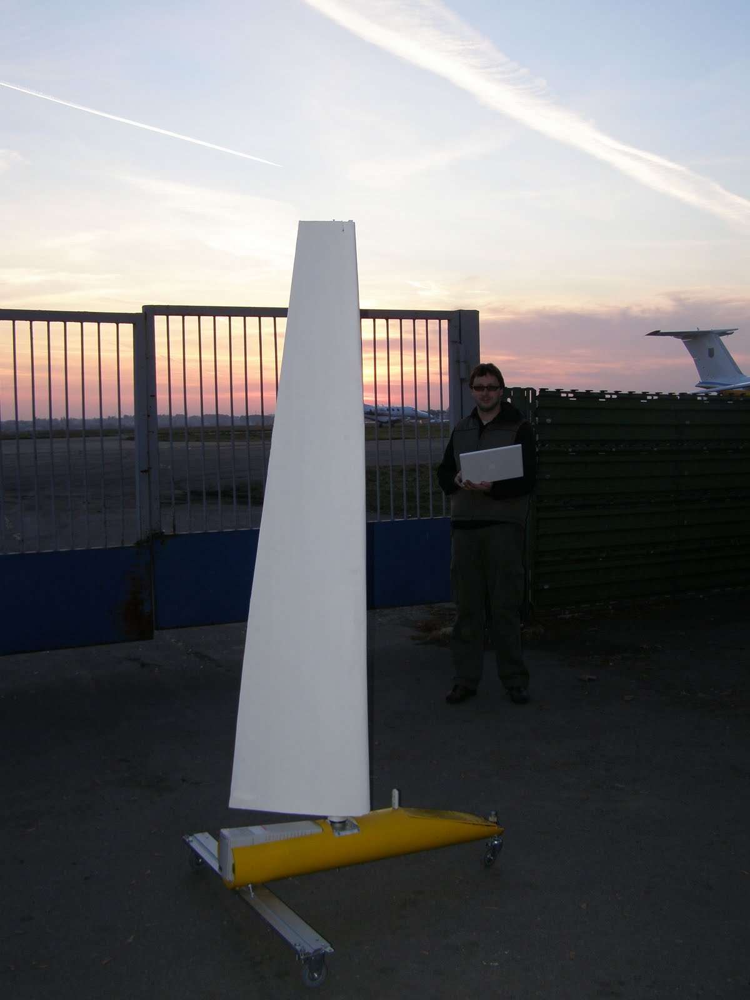

After all these years (how strange that sounds now that everything is finished), the time finally came for field trials.
Over time, the original idea—"let's build a robot yacht"—evolved as follows:

- To simplify testing, we initially moved away from a waterborne prototype and put it on skis. After a few winters of realizing that ideal hard-packed snow crust is nearly impossible to find, we switched to wheels.
- The multi-section wing sail was simplified into a single rotating wing sail.
- The requirement for a hermetically sealed hull turned into "just keep gaps sealed" while maintaining adequate heat exchange.

What changed even more over the years was the core of the system—the computer. The test prototype was designed almost entirely around an industrial single-board computer and a standard UPS battery. Today, those design choices bring a smile to my face, as everything could now fit into a fraction of the volume and weight.

Here is the result of the work:

The vehicle turned out to be quite heavy—around 20 kg—which dramatically increased the wind speed required to move it.

This made testing even more challenging and limited the data we could gather. The heavy weight overloaded the front support, and toward the end of the trials, the steering gearbox failed. The small wheel diameter and lack of suspension damping caused vibrations and extra rolling resistance. Since the wind wasn't strong enough to overcome initial static friction, rather "archaic methods" had to be used to give the vehicle an initial push :-)

Based on the results, I decided to dismantle the prototype:
- Further upgrades wouldn't yield significant progress due to its outdated hardware base
- Limitations of the mechanical components
- We obtained the necessary experimental data—which was the whole point of the prototype in the first place
- Invaluable design and construction experience was gained, and all the rookie mistakes have now been made :-)

So, the test is complete, the first prototype has been disassembled, and work has begun on the second one!

<video controls width="480" height="360">
  <source src="../assets/videos/2010-11-02-final-test-roboyacht/video-1.mp4" type="video/mp4">
</video>

<video controls width="480" height="360">
  <source src="../assets/videos/2010-11-02-final-test-roboyacht/video-2.mp4" type="video/mp4">
</video>

<video controls width="480" height="360">
  <source src="../assets/videos/2010-11-02-final-test-roboyacht/video-3.mp4" type="video/mp4">
</video>
